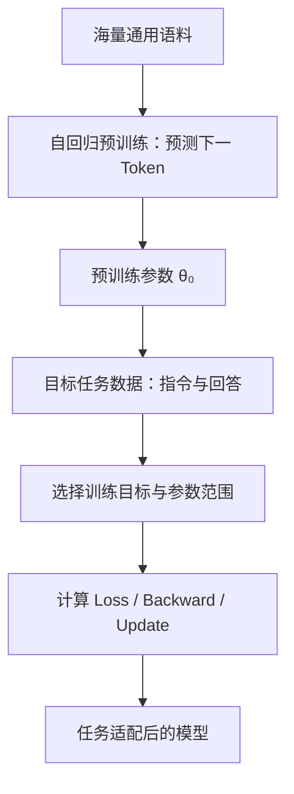
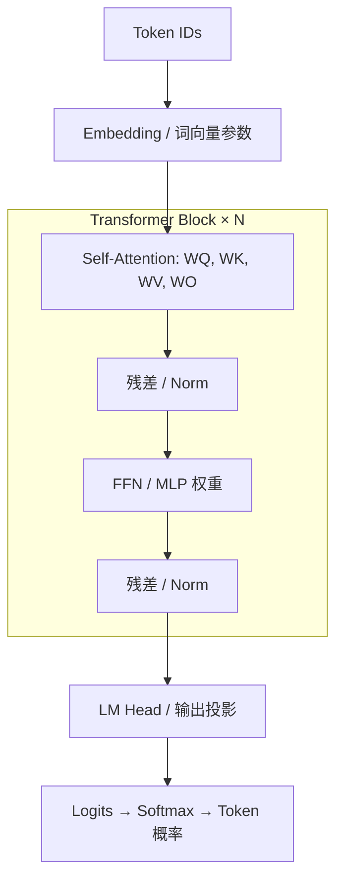

# 第 01 章｜大模型微调基础

> [!abstract] 一句话结论
> 微调是在**预训练权重的基础上**，使用目标任务数据和损失函数，更新选定参数，让模型产生更符合任务要求的输出。**SFT 决定学什么，PEFT 决定改哪里，联邦学习决定在哪里协作训练。**

**课程导航：** [[02-全量微调]] → [[03-LoRA与QLoRA]] → [[04-Prompt-based微调]] → [[05-Adapter微调]] → [[06-Selective与其他高效方法]] → [[07-联邦大模型微调]] → [[08-方法对比与技术选型]] → [[09-完整微调实践]]

## ① 核心原理：预训练、微调与三种分类维度

### 1.1 预训练与微调



- **Pre-training**：常用自回归目标学习通用文本统计规律，得到基础模型参数 $\theta_0$。
- **Fine-tuning**：从 $\theta_0$ 出发，继续利用目标任务数据训练；不是从零随机初始化。
- **SFT（Supervised Fine-Tuning）**：使用 `(输入, 期望回答)` 配对数据进行监督训练。例：`判断“很好吃”的情感 → 积极`。
- **PEFT（Parameter-Efficient Fine-Tuning）**：训练目标可以仍是 SFT，但只更新少量参数或附加模块。

> [!important] 不要混为一谈
> - **训练目标**：SFT、偏好优化等，回答“以什么监督信号学习”。
> - **参数更新策略**：Full Fine-Tuning、LoRA、Prompt、Adapter、Selective，回答“更新哪些参数”。
> - **组织方式**：集中式、本地式、联邦式，回答“谁持有数据以及如何协同”。
>
> 例如 **联邦 SFT + LoRA** 是三个维度的组合，而不是三个相互排斥的选择。

### 1.2 数据组织的三种范式

| 范式 | 原始数据 | 模型更新 | 关键问题 |
|---|---|---|---|
| 集中式 | 汇总到服务器 | 统一训练 | 数据集中与合规风险 |
| 独立本地 | 留在各客户端 | 各自训练、不聚合 | 数据分散，难共享跨客户端知识 |
| 联邦式 | 留在各客户端 | 上传更新、服务器聚合 | 通信、Non-IID、隐私泄露风险 |

联邦训练通常交换参数或更新，**不上传原始样本并不等于拥有严格的隐私保证**。

## ② 图解机制：Transformer 中哪些地方可以训练？



> [!note] 图示是抽象结构
> 不同 LLM 的 Norm 位置、FFN 结构、GQA 设计和权重共享可能不同；例如部分模型使用 RMSNorm 而非 LayerNorm。

Attention（单头、采用行向量隐藏表示）：

$$
Q=HW_Q,\quad K=HW_K,\quad V=HW_V
$$

$$
\operatorname{Attention}(Q,K,V)=\operatorname{softmax}\left(\frac{QK^\top}{\sqrt{d_k}}\right)V
$$

模型输出由各层参数与输入共同决定。**冻结权重**只表示优化器不更新它们，并不表示该层不参与前向计算，或误差信号不会经该层传播到其他可训练参数。

| 策略 | 冻结/更新 |
|---|---|
| Full Fine-Tuning | 基座全部可训练参数更新 |
| LoRA | 基座冻结，新增低秩 $A,B$ 更新 |
| Prompt Tuning | 基座冻结，输入提示向量 $P$ 更新 |
| Adapter | 基座冻结，插入的小型网络更新 |
| Selective | 只解冻原基座中的某些参数 |

## ③ 数学与代码：SFT 为什么能学到正确回答？

### 3.1 自回归语言模型的损失

一段 Token 序列 $x_1,\dots,x_T$ 的负对数似然：

$$
\mathcal L(\theta)=-\sum_{t=1}^T\log p_\theta(x_t\mid x_{<t})
$$

实践中通常只对需要监督的回答 Token 求平均损失；用户指令、Padding 等位置可以被 mask。

对于目标 Token $y$、词表 Logits $z_j$：

$$
p_j=\frac{e^{z_j}}{\sum_k e^{z_k}},\qquad \ell=-\log p_y
$$

其核心梯度是：

$$
\boxed{\frac{\partial\ell}{\partial z_j}=p_j-\mathbf1[j=y]}
$$

因此正确 Token 对应的 Logit 梯度通常为负，梯度下降倾向于提高其相对 Logit；其他 Token 对应的梯度为正。梯度继续通过链式法则传回模型参数。

### 3.2 一个典型训练步

$$
\boxed{\theta_{t+1}=\theta_t-\eta\nabla_\theta\mathcal L(\theta_t)}
$$

```python
# 假设 model、optimizer、input_ids、prompt_len 已准备好
labels = input_ids.clone()
labels[:prompt_len] = -100  # 不监督输入指令部分

optimizer.zero_grad(set_to_none=True)
output = model(
    input_ids=input_ids.unsqueeze(0),
    labels=labels.unsqueeze(0),
)
loss = output.loss
loss.backward()       # 计算梯度
optimizer.step()      # 真正更新参数
```

> [!warning] 标签对齐
> 在 Hugging Face `AutoModelForCausalLM` 中，模型一般内部处理 next-token shift。聊天模型应通过 `apply_chat_template()` 构造指令和回答，再确保答案起始位置的 labels 正确，而不是硬编码原始文本长度。

全量微调的优化对象：$\arg\min_\theta\mathcal L(\theta)$；PEFT 可抽象为固定 $\theta_0$ 后优化少量参数：

$$
\phi^*=\arg\min_\phi\mathcal L(\theta_0,\phi)
$$

这里的 $\phi$ 既可以是新增参数，也可以是从原模型中选取的参数子集。

## ④ 对比与自检

| 概念 | 一句话理解 |
|---|---|
| Pre-training | 从大规模语料学习通用预测规律 |
| SFT | 用期望回答监督模型的输出行为 |
| PEFT | 减少可训练参数的适配方法 |
| Federated Fine-Tuning | 数据留本地，多个客户端交换模型更新协作训练 |
