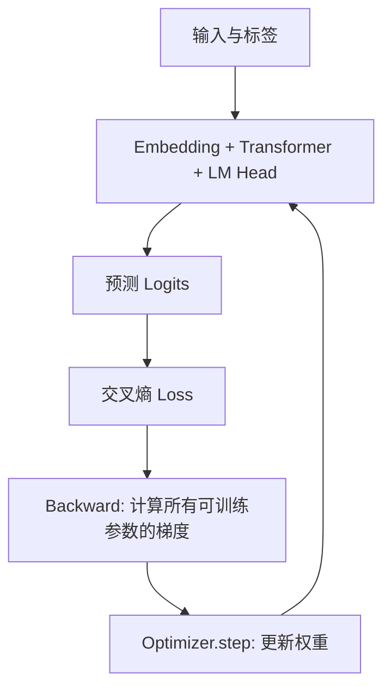

# 第 02 章｜全量微调（Full Fine-Tuning）

> [!abstract] 核心结论
> **全量微调**从预训练参数出发，利用目标任务损失对**全部可训练参数**进行反向传播与优化。它提供最大的参数调整空间，但训练显存、优化器状态、通信与保存成本高。

**导航：** [[01-大模型微调基础]] ← 上一章 · 下一章 → [[03-LoRA与QLoRA]]

## ① 核心原理：更新全部参数

给定预训练参数 $\theta_0$、任务数据 $D=\{(x_i,y_i)\}_{i=1}^N$：

$$
\boxed{\theta^*=\arg\min_\theta\frac1N\sum_{i=1}^N\mathcal L(f_\theta(x_i),y_i)}
$$

- 初始值为 $\theta_0$，**不是随机初始化**。
- Embedding、Attention、FFN、Norm 和可训练输出层通常都允许更新（实际看架构）。
- 训练目标可以是 SFT 的 Token 交叉熵，也可使用其他目标；**FFT 指参数更新范围，不指定损失函数**。

| 维度 | 从零预训练 | Full Fine-Tuning |
|---|---|---|
| 初始权重 | 通常随机 | 已有模型 $\theta_0$ |
| 数据 | 海量通用语料 | 目标任务语料 |
| 更新参数 | 通常全部 | 全部可训练参数 |
| 目标 | 建立通用能力 | 调整任务表现 |

## ② 图解机制：前向、反向和优化器



### 2.1 一个样本为什么可以更新整个矩阵？

令 $h=Wx$，$W\in\mathbb R^{m\times d}$、$x\in\mathbb R^d$、$h\in\mathbb R^m$，并记 $\delta=\partial\mathcal L/\partial h$。

$$
h_i=\sum_{j=1}^dW_{ij}x_j
$$

$$
\frac{\partial\mathcal L}{\partial W_{ij}}=\delta_i x_j
$$

于是整层的梯度为：

$$
\boxed{\frac{\partial\mathcal L}{\partial W}=\delta x^\top}
$$

**数值实例：** $x=[2,1]^\top$、$\delta=[0.3,-0.2]^\top$，则：

$$
\nabla_W\mathcal L=\begin{bmatrix}0.6&0.3\\-0.4&-0.2\end{bmatrix}
$$

SGD 学习率 $\eta=0.1$ 对应更新量：

$$
\Delta W=-0.1\nabla_W\mathcal L=\begin{bmatrix}-0.06&-0.03\\0.04&0.02\end{bmatrix}
$$

> [!note] 细节
> “全部参数可训练”不意味着每个参数每次更新都非零。梯度为零、没有经过相应路径等情况，可能导致局部元素保持不变。

## ③ 数学与代码：显存为什么远大于权重文件？

### 3.1 训练显存构成

$$
\boxed{M_{\mathrm{total}}\approx M_W+M_G+M_O+M_A+M_{\mathrm{other}}}
$$

| 项目 | 保存什么 | 典型影响 |
|---|---|---|
| $M_W$ | 模型权重 | 参数量 × 权重精度 |
| $M_G$ | 梯度 | 可训练参数数量与梯度类型 |
| $M_O$ | AdamW 一阶/二阶矩等 | 可能占很大比例 |
| $M_A$ | 反向传播所需激活 | Batch、序列长度、层数 |
| $M_{\mathrm{other}}$ | 临时缓冲、CUDA 等 | 实现与硬件有关 |

**7B 参数的理想化估算（十进制 GB）：** 假设 BF16 权重每参数 2B、BF16 梯度每参数 2B、Adam 两个 FP32 状态每参数共 8B：

| 权重 | 梯度 | Adam 状态 | 三项合计 |
|---:|---:|---:|---:|
| 14 GB | 14 GB | 56 GB | **84 GB** |

这**不包含中间激活**、可能的 FP32 master weights、其他缓冲。不同框架使用的状态存储方式可能不同，故它不是通用训练最低显存。综述在自身实验设置下报告了不同的实测值（LLaMA2-7B 约 51.85GB），不能混为一谈。

AdamW 的两个状态（逐元素）：

$$
m_t=\beta_1m_{t-1}+(1-\beta_1)g_t
$$

$$
v_t=\beta_2v_{t-1}+(1-\beta_2)g_t^2
$$

### 3.2 什么因素扩大激活显存？

- **Batch Size**：同时处理更多序列，需要更多保存的隐藏状态。
- **Sequence Length**：更长上下文，通常增加激活与 Attention 工作量。
- **层数与宽度**：更多中间表示；具体比例取决于计算图与 FlashAttention、Checkpointing 等实现。

> [!important] 核心判断
> 可训练参数减少 99% 不代表计算量、激活显存或训练耗时同步减少 99%。这是后续选 LoRA/QLoRA 时要持续检查的条件。

### 3.3 最小训练循环

```python
import torch

# 假设 model、train_loader、设备与 labels 都已准备好
for p in model.parameters():
    p.requires_grad = True

optimizer = torch.optim.AdamW(model.parameters(), lr=2e-5)
model.train()
for batch in train_loader:
    optimizer.zero_grad(set_to_none=True)
    out = model(**batch)
    loss = out.loss
    loss.backward()
    torch.nn.utils.clip_grad_norm_(model.parameters(), 1.0)
    optimizer.step()
```

代码逻辑：

1. `requires_grad=True`：允许全部权重参与优化。
2. `backward()`：计算参数梯度；并不更新权重。
3. `optimizer.step()`：使用梯度更新权重。

完整训练还应加数据编码、模型设备、学习率调度、混合精度、验证与保存等。

### 3.4 联邦 FFT 的通信成本

FedAvg 使用：

$$
\theta_{t+1}=\sum_{k\in S_t}\frac{n_k}{\sum_{j\in S_t}n_j}\theta^{(k)}_{t,E}
$$

如果一个 7B 模型的更新以 BF16 密集形式上传，**单次上传一个客户端约 14GB**（不含额外开销）。10 轮仅上传约 140GB；如果也下发同规模权重，双向通信会更高。正因如此，联邦 LLM 经常使用 PEFT。

## ④ 对比与自检

| 问题 | 判断 |
|---|---|
| 全量微调是不是从零训练？ | 不是，从预训练权重开始。 |
| 参数更多是否必然更好？ | 不是，可能过拟合且优化更困难。 |
| FFT 一定比 LoRA 效果好？ | 不一定，要看任务、数据和预算。 |
| 什么情况下考虑 FFT？ | 需要广泛改动模型、数据和算力充足且实际验证有效。 |

