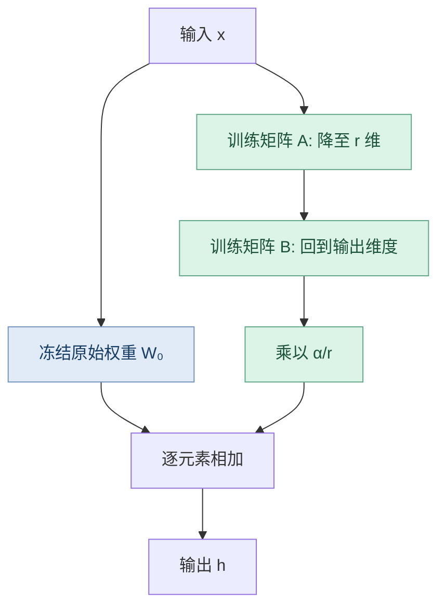
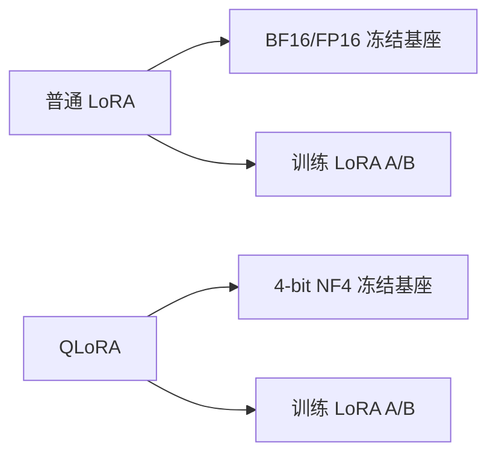

# 第 03 章｜LoRA、QLoRA 与低秩微调

> [!abstract] 核心结论
> **LoRA 学习低秩权重增量 $\Delta W=BA$，冻结原始权重 $W_0$。QLoRA 在此基础上使用 4-bit 量化存储基座权重，进一步减少显存。** LoRA 解决“训练多少参数”，QLoRA 额外解决“怎样存储冻结基座”。

**导航：** [[02-全量微调]] ← 上一章 · 下一章 → [[04-Prompt-based微调]] · 聚合细节见 [[07-联邦大模型微调]]

## ① 核心原理：LoRA 为什么成立？

对线性层：

$$
h=W_0x+\Delta Wx
$$

LoRA 不要求 **$W_0$ 本身低秩**，而是假设适配任务所需的变化可以有效地限制在低秩空间：

$$
\boxed{\Delta W=BA},\quad A\in\mathbb R^{r\times d_{in}},\ B\in\mathbb R^{d_{out}\times r}
$$

经典 LoRA 通常使用缩放系数 $s=\alpha/r$：

$$
\boxed{h=W_0x+\frac{\alpha}{r}BAx}
$$

- $W_0\in\mathbb R^{d_{out}\times d_{in}}$：冻结基座权重。
- $A$：先把输入投影到低维空间。
- $B$：再映射回输出维度。
- $r\ll \min(d_{in},d_{out})$：低秩维度，限制更新矩阵的秩。

$$
\operatorname{rank}(BA)\le r
$$

参数量对比：

$$
P_{full}=d_{out}d_{in},\qquad P_{LoRA}=r(d_{in}+d_{out})
$$

若 $d_{in}=d_{out}=4096$、$r=8$：

- 原权重：16,777,216 个参数。
- LoRA：65,536 个可训练参数。
- 对**该线性层**的占比：$0.390625\%$，减少约 99.61%。不能直接视作整个模型比例或显存降幅。

## ② 图解机制：LoRA 两路计算与 QLoRA



### 2.1 初始化与训练顺序

经典初始化：$A$ 随机、$B=0$，于是最初 $BA=0$，模型输出与基座一致。首次更新通常先作用于 $B$，之后 $A,B$ 共同学习。

常见注入位置：Attention 的 `q_proj`、`v_proj`，也可包括 `k_proj`、`o_proj` 与 FFN 的 `gate_proj` / `up_proj` / `down_proj`。具体名称取决于模型架构，不能随意照搬。

### 2.2 QLoRA 如何节省显存？



QLoRA 的关键技术：

| 技术 | 含义 |
|---|---|
| NF4 | 面向近似正态分布权重的 4-bit 非均匀数值表示，降低量化误差 |
| Double Quantization | 再量化量化常数，节省元数据存储 |
| Paged Optimizers | 使用分页内存机制应对峰值显存压力 |

7B 权重的理想化主体存储：BF16 $\approx14$GB，4-bit $\approx3.5$GB。**真实 QLoRA 训练显存还包括 LoRA、激活、优化器、量化元数据、临时缓冲等。** QLoRA 不是对整个模型做 4-bit 全参数训练。

## ③ 数学与代码：梯度、rank、合并

### 3.1 A、B 的梯度

设 $W_{eff}=W_0+sBA$，且 $G=\partial\mathcal L/\partial W_{eff}$，由 $d(BA)=dB\,A+B\,dA$：

$$
\boxed{\frac{\partial\mathcal L}{\partial B}=sGA^\top}\qquad
\boxed{\frac{\partial\mathcal L}{\partial A}=sB^\top G}
$$

当 $B=0$ 时，第一次反向传播 $\partial\mathcal L/\partial A=0$，而 $\partial\mathcal L/\partial B$ 通常非零。若 A、B 都全零，初始梯度会同时为零，无法开始常规学习。

### 3.2 rank、alpha 与 dropout

| 超参数 | 主要作用 | 注意 |
|---|---|---|
| `r` | 低秩维度 | 更大并不保证验证效果更好 |
| `lora_alpha` | 更新分支的缩放 | 经典为 $\alpha/r$ |
| `lora_dropout` | 对 LoRA 分支正则化 | 过大可能妨碍拟合 |
| `target_modules` | 向哪些层注入 LoRA | 对参数量及效果影响巨大 |

rsLoRA 将缩放改为 $\alpha/\sqrt r$，适用于探索更大 rank 的训练稳定性；AdaLoRA 动态分配参数预算；DoRA 分离权重幅度与方向。这些是结构性思路，非普遍性能排序。

### 3.3 合并权重

$$
W_{merged}=W_0+sBA
$$

不启用训练时的随机 dropout 等操作时，普通 LoRA 线性分支通常可并入权重矩阵，从而避免推理阶段额外计算分支。QLoRA 涉及反量化/再量化，合并可能引入数值误差。

### 3.4 简化 PyTorch 代码

```python
import math
import torch
import torch.nn as nn

class LoRALinear(nn.Module):
    def __init__(self, d_in, d_out, r=8, alpha=16):
        super().__init__()
        self.base = nn.Linear(d_in, d_out, bias=False)
        for p in self.base.parameters():
            p.requires_grad = False
        self.A = nn.Parameter(torch.empty(r, d_in))
        self.B = nn.Parameter(torch.zeros(d_out, r))
        nn.init.kaiming_uniform_(self.A, a=math.sqrt(5))
        self.scale = alpha / r

    def forward(self, x):
        return self.base(x) + self.scale * ((x @ self.A.T) @ self.B.T)
```

> [!warning] 此代码只演示线性层结构
> `self.base` 必须在实际任务中加载预训练权重。完整 LLM 训练还要配置数据、目标层与优化器。

### 3.5 PEFT / QLoRA 配置核心

```python
import torch
from transformers import AutoModelForCausalLM, BitsAndBytesConfig
from peft import LoraConfig, get_peft_model, prepare_model_for_kbit_training

quant = BitsAndBytesConfig(
    load_in_4bit=True,
    bnb_4bit_quant_type="nf4",
    bnb_4bit_use_double_quant=True,
    bnb_4bit_compute_dtype=torch.bfloat16,
)
base = AutoModelForCausalLM.from_pretrained(
    "Qwen/Qwen2.5-0.5B-Instruct",
    quantization_config=quant,
    device_map="auto",
)
base = prepare_model_for_kbit_training(base)
config = LoraConfig(
    r=8, lora_alpha=16, lora_dropout=0.05,
    target_modules=["q_proj", "v_proj"], task_type="CAUSAL_LM"
)
model = get_peft_model(base, config)
model.print_trainable_parameters()
```

需要兼容的 CUDA / `bitsandbytes` 环境及适合 BF16 的 GPU；该代码只创建模型与可训练参数，尚未提供数据和训练循环。完整训练见 [[09-完整微调实践]]。

## ④ 比较与自检

| 维度 | LoRA | QLoRA |
|---|---|---|
| 基座存储 | 常见 BF16/FP16 | 常见 4-bit NF4 |
| 可训练部分 | A、B | A、B |
| 核心收益 | 可训练参数少 | 进一步降低冻结基座权重显存 |
| 主要代价 | 低秩更新约束 | 量化误差与额外数值计算 |
| 训练速度 | 依赖配置与硬件 | **不一定**快于 LoRA |
