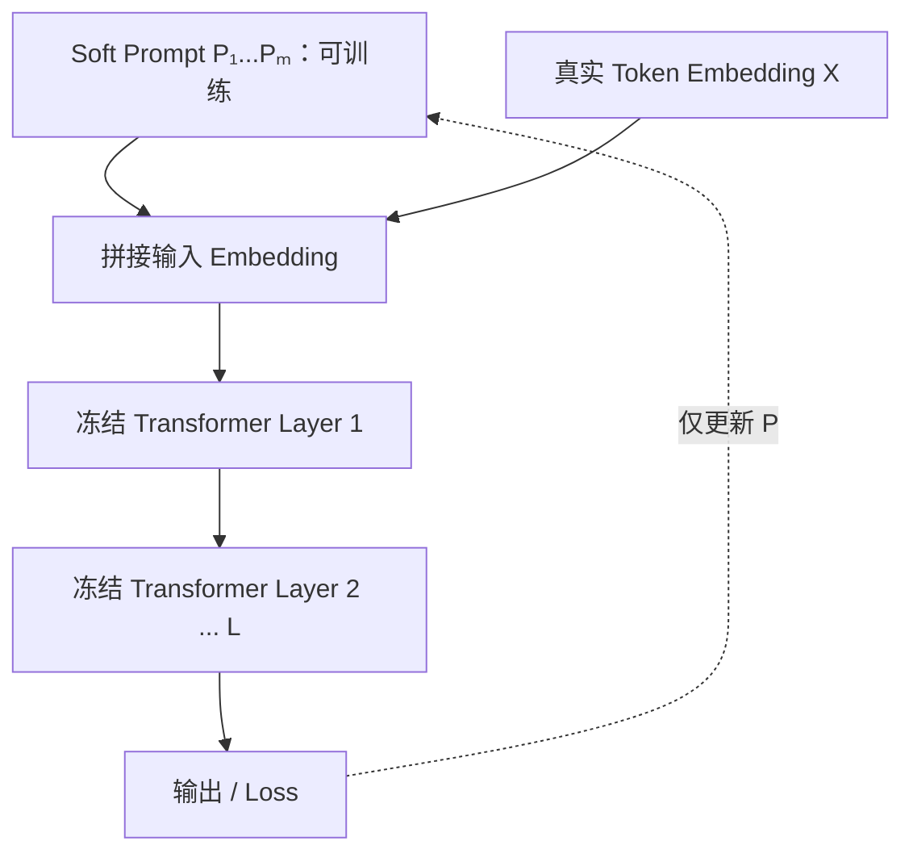
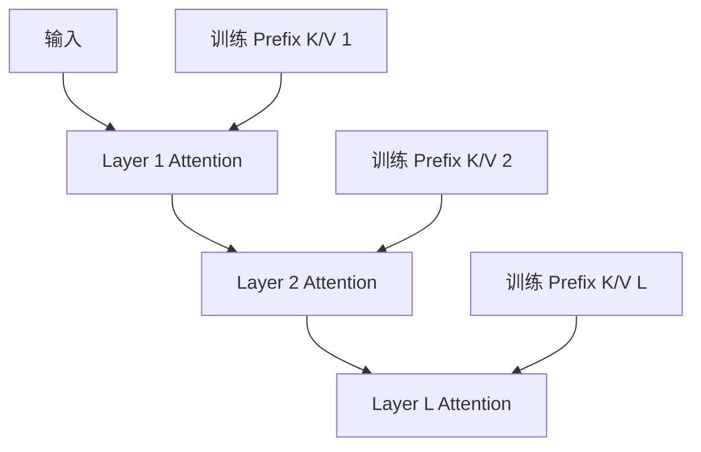
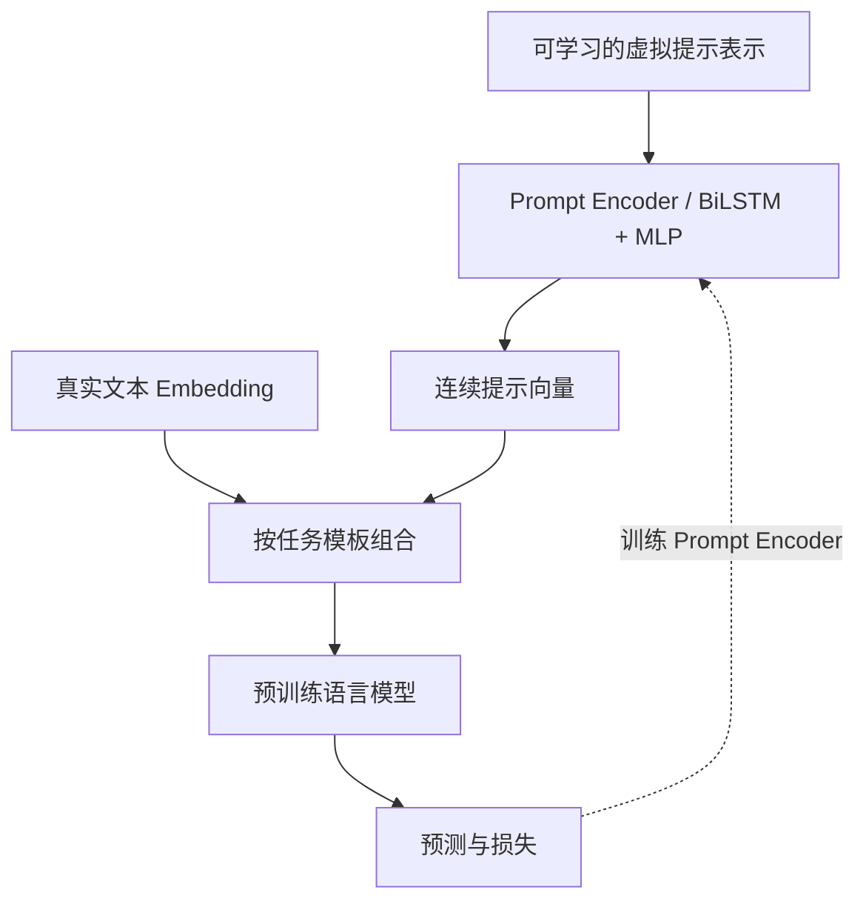

# 第 04 章｜Prompt-based Tuning（提示微调）

> [!abstract] 核心结论
> **Prompt-based Tuning** 不直接修改预训练模型权重，而是学习一组连续提示向量来改变隐藏表示或 Attention 计算。**经典 Prompt Tuning 在输入端添加提示，Prefix Tuning 和 P-Tuning v2 在更深层注入提示。**

**导航：** [[03-LoRA与QLoRA]] ← 上一章 · 下一章 → [[05-Adapter微调]]

## ① 核心原理：Hard Prompt、Soft Prompt 与可训练变量

**Hard Prompt** 是人可读的文本指令，如“判断以下文本情感，只回答积极/消极”。直接编写提示不必执行参数学习，通常属于 Prompt Engineering。

**Soft Prompt** 是可微、可训练的连续向量，一般不能直接解释为词表里的自然语言单词；虽然称 Virtual Tokens，但不表示一定创建了新的真实词表条目。

给定真实输入 Embedding：

$$
X\in\mathbb R^{n\times d}
$$

附加 $m$ 个可训练提示向量：

$$
P\in\mathbb R^{m\times d}
$$

拼接后：

$$
X'=[P;X]\in\mathbb R^{(m+n)\times d}
$$

冻结模型参数 $\theta_0$，只训练 $P$：

$$
\boxed{P^*=\arg\min_P\mathcal L(f_{\theta_0}([P;X]),y)}
$$

### 1.1 为什么不更新权重也能改变输出？

Transformer 中：

$$
Q=X'W_Q,\quad K=X'W_K,\quad V=X'W_V
$$

虽然 $W_Q,W_K,W_V$ 冻结，但 $X'$ 改变了，所以 $Q,K,V$ 和注意力输出发生变化。自回归模型中后续真实 Token 可以关注位于前面的 Soft Prompt。

> [!important] 冻结 ≠ 无反向计算
> 为更新 $P$，Loss 的梯度通常仍需要穿过冻结的 Transformer 计算路径。只训练极少参数不等于前后向开销也接近于零。

## ② 图解机制：四种 Prompt 技术

### 2.1 Prompt Tuning——输入端连续提示



核心特征：只在输入端直接添加可学习向量；后续层仍可通过 Attention 使用前面传来的提示信息。

### 2.2 Prefix Tuning——每层 Attention 的 K/V 前缀

对第 $l$ 层，构造可训练的 $P_K^{(l)}$、$P_V^{(l)}$：

$$
\widetilde K_l=[P_K^{(l)};K_l],\quad\widetilde V_l=[P_V^{(l)};V_l]
$$

$$
\boxed{\operatorname{Attn}_l=\operatorname{softmax}\left(\frac{Q_l\widetilde K_l^\top}{\sqrt{d_k}}\right)\widetilde V_l}
$$



这里的前缀可直接影响目标层的 Attention，而非仅在模型开头插入额外 Embedding。原始 Prefix Tuning 可以通过重参数化网络辅助训练，再在推理时使用生成的前缀。

### 2.3 P-Tuning——Prompt Encoder



关键点：通过 Prompt Encoder 建模连续提示，提示位置可由任务模板定义，并不必都固定在开头。经典 P-Tuning 论文中存在不同的冻结/解冻实验设置；作为 PEFT 时重点关注冻结基座的配置。

### 2.4 P-Tuning v2——Deep Prompt Tuning

每个目标层可以有自己的提示表示：

$$
P^{(1)},P^{(2)},\ldots,P^{(L)}
$$

它与 Prefix Tuning 的**深层注入机制**较接近，不应理解成简单延长输入前缀。P-Tuning v2 特别强调自然语言理解任务（分类、序列标注等）。论文中的性能结论只对相关实验模型与任务成立。

| 方法 | 提示位置 | 特殊机制 | 常见资源特点 |
|---|---|---|---|
| Prompt Tuning | 输入层 | 直接学习 $P$ | 参数最少的一类 |
| Prefix Tuning | 多个 Attention 层 | 可学习 K/V Prefix | 多层直接控制，但前缀更大 |
| P-Tuning | 输入/任务模板位置 | Prompt Encoder | 提示建模更灵活 |
| P-Tuning v2 | 多层 | Deep Prompt | 对 NLU 任务有针对性设计 |

## ③ 数学与代码：梯度和参数量

### 3.1 提示向量梯度

如果简化为冻结线性变换 $H=PW$、上游梯度 $G_H=\partial\mathcal L/\partial H$，则：

$$
\boxed{\frac{\partial\mathcal L}{\partial P}=G_HW^\top}
$$

$W$ 冻结，却仍然参与传播梯度；更新为：

$$
P_{t+1}=P_t-\eta\frac{\partial\mathcal L}{\partial P_t}
$$

### 3.2 参数规模

经典 Prompt Tuning：

$$
\boxed{N_{prompt}=md}
$$

例如 $m=20,d=4096$：81,920 个参数。

简化的每层独立 K/V Prefix 存储方式：

$$
\boxed{N_{prefix}\approx2Lmd}
$$

$L=32,m=20,d=4096$ 时约为 5,242,880 个参数。实际实现若采用 Prefix Encoder 或共享结构则会不同。

### 3.3 Hugging Face PEFT 三种配置

```python
from transformers import AutoModelForCausalLM
from peft import (
    PromptTuningConfig, PrefixTuningConfig,
    PromptEncoderConfig, get_peft_model,
)

base = AutoModelForCausalLM.from_pretrained("Qwen/Qwen2.5-0.5B-Instruct")

# 每次只选择一种 config
config = PromptTuningConfig(
    task_type="CAUSAL_LM", num_virtual_tokens=20
)
# config = PrefixTuningConfig(task_type="CAUSAL_LM", num_virtual_tokens=20)
# config = PromptEncoderConfig(
#     task_type="CAUSAL_LM", num_virtual_tokens=20,
#     encoder_hidden_size=128
# )
model = get_peft_model(base, config)
model.print_trainable_parameters()
```

> [!warning] API 和论文方法不能机械一一对应
> `PromptEncoderConfig` 对应经典 P-Tuning 的编码器思想，并不自动等于 P-Tuning v2。不同模型类型和 PEFT 版本对 Prefix 的支持可能不同，实际运行须检验。

## ④ 联邦 Prompt、方法比较与自检

综述将联邦 Prompt 分为：

1. **General**：客户端共享兼容的提示结构，聚合公共 $P$。
2. **Personalized**：公共提示配合本地个性化提示。
3. **Multi-Domain**：不同领域提示与共享知识的协同学习。

简化的全局提示聚合：

$$
P^{t+1}=\sum_kp_kP_k^{t+1}
$$

仅当各客户端 Prompt 维度与语义位置兼容时才适合直接平均。

| 需求 | 首先考虑 |
|---|---|
| 极小通信、简单任务 | Prompt Tuning |
| 深层 Attention 控制 | Prefix Tuning |
| 可学习的任务模板表示 | P-Tuning |
| NLU、序列标注与深层提示 | P-Tuning v2 |
| 通用生成适配空间更大 | 与 LoRA 比较，不能预设优劣 |
