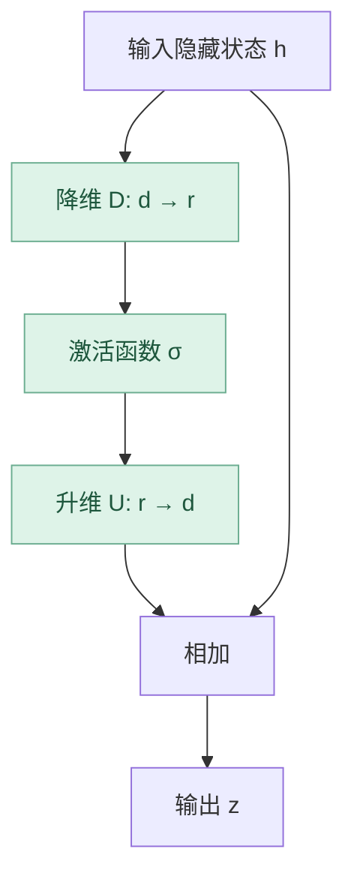
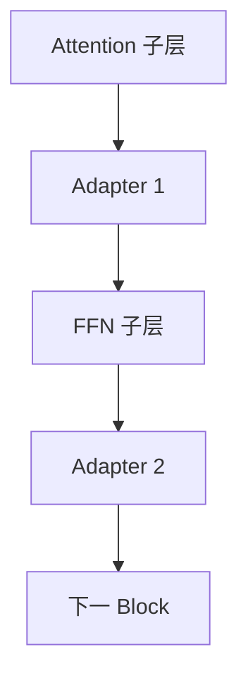
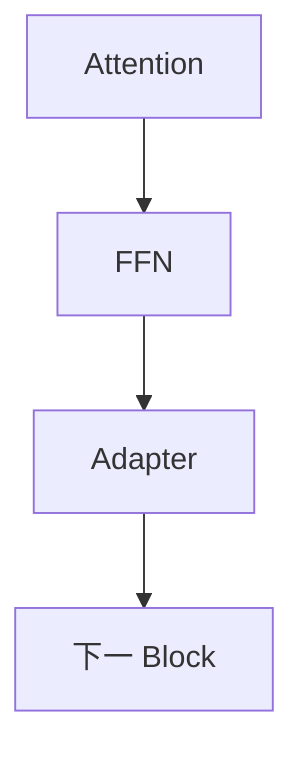
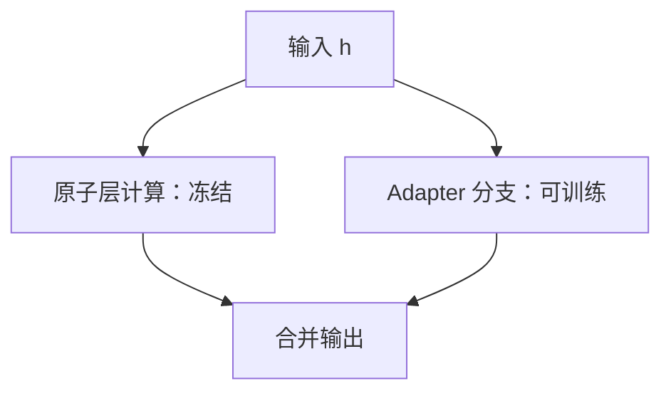

# 第 05 章｜Adapter-based Tuning（适配器微调）

> [!abstract] 核心结论
> Adapter 在冻结基座模型的情况下，**插入小型可训练神经网络来改变中间隐藏表示**。经典瓶颈 Adapter 的核心是 $z=h+U\sigma(Dh)$；与经典 LoRA 的低秩线性权重增量不同，它通常包含非线性激活。

**导航：** [[04-Prompt-based微调]] ← 上一章 · 下一章 → [[06-Selective与其他高效方法]]

## ① 核心原理：瓶颈结构与残差连接

假设模型中间隐藏向量为 $h\in\mathbb R^d$；令 $r\ll d$，降维矩阵 $D\in\mathbb R^{r\times d}$，升维矩阵 $U\in\mathbb R^{d\times r}$。

$$
a=Dh,\qquad b=\sigma(a),\qquad c=Ub
$$

通过残差相加：

$$
\boxed{z=h+U\sigma(Dh)}
$$

- **Down Projection**：$d\to r$，减小适配分支的宽度。
- **Nonlinearity**：ReLU、GELU 等，增加非线性表达能力。
- **Up Projection**：$r\to d$，回到原隐藏维度。
- **Residual**：保留原隐藏表示的旁路，学习修正量。



主要矩阵参数数目：

$$
\boxed{P_{Adapter}\approx 2dr}
$$

例如 $d=4096,r=16$，新增约 131,072 个矩阵参数，未计偏置、Norm 等。若每层 $k$ 个、共 $L$ 层：$P\approx 2Lkdr$。

## ② 图解机制：Adapter 插在哪里？

### 2.1 Houlsby（双位置插入）

一个典型 Transformer Block 中，在 Attention 子层与 FFN 子层之后分别放置适配器。



### 2.2 Pfeiffer（单位置插入）

通常在 FFN 子层相关位置插入一个 Adapter，参数和模块数量更少。



### 2.3 Parallel Adapter（并行结构）



> [!note] 抽象示意
> 图中略去了 LayerNorm、子层本来的残差与具体排序，不等同于某一 Transformer 实现的完整逐算子计算图。

| 结构 | 插入方式 | 主要权衡 |
|---|---|---|
| Houlsby | 每层两个 Adapter | 控制位置较多，参数更多 |
| Pfeiffer | 每层一个 Adapter | 简洁、成本较低 |
| Parallel | 与原子层并行 | 额外分支不串行插在子层之后 |

### 2.4 多任务适配器

同一冻结基座 $\theta_0$ 可以配合不同任务模块 $\phi_A,\phi_B,\phi_C$，推理时按任务选择对应 Adapter。模块化管理是其优势，但训练、路由和热切换机制仍需正确实现。

## ③ 数学与代码：梯度、初始化和与 LoRA 的区别

### 3.1 推导 $U,D$ 的梯度

设 $a=Dh$，$b=\sigma(a)$，$z=h+Ub$，上游梯度 $g=\partial\mathcal L/\partial z$。

升维权重：

$$
\boxed{\frac{\partial\mathcal L}{\partial U}=gb^\top}
$$

降维权重：先计算

$$
\delta=(U^\top g)\odot\sigma'(Dh)
$$

再得：

$$
\boxed{\frac{\partial\mathcal L}{\partial D}=\delta h^\top}
$$

输入梯度：

$$
\boxed{\frac{\partial\mathcal L}{\partial h}=g+D^\top\delta}
$$

其中 $g$ 来自残差旁路，允许误差信号继续传播。即使原模型权重冻结，也不代表整条路径“没有梯度计算”。

### 3.2 初始化细节

一种常见策略是 $D$ 随机、$U=0$：

$$
z=h+0\cdot\sigma(Dh)=h
$$

初始插入时不改变隐藏状态；第一次反向传播通常只让 $U$ 获得非零梯度。注意并非全部实现都采用这一初始化。

### 3.3 为什么 Adapter 不等同于 LoRA？

LoRA：

$$
h=W_0x+BAx
$$

Adapter：

$$
z=h+U\sigma(Dh)
$$

若没有非线性，$z=(I+UD)h$，有时可以与线性层合并。但当 $\sigma$ 为 ReLU/GELU 时，不能通常使用**一个固定线性矩阵**来完全表示该变换。

| 特征 | LoRA | Bottleneck Adapter |
|---|---|---|
| 修改对象 | 有效权重的线性增量 | 中间隐藏表示 |
| 新增非线性 | 经典形式没有 | 通常有 |
| 推理合并 | 普通 LoRA 通常可并入权重 | 一般需保留模块计算 |
| 多任务模块切换 | 可以 | 可以 |
| 是否保证性能更好 | 否 | 否 |

### 3.4 最小代码

```python
import torch
import torch.nn as nn

class BottleneckAdapter(nn.Module):
    def __init__(self, d=4096, r=16):
        super().__init__()
        self.down = nn.Linear(d, r, bias=False)
        self.act = nn.ReLU()
        self.up = nn.Linear(r, d, bias=False)
        nn.init.zeros_(self.up.weight)

    def forward(self, h):
        return h + self.up(self.act(self.down(h)))

# 简化示例：已有层 + Adapter
base = nn.Linear(32, 32, bias=False)
for p in base.parameters():
    p.requires_grad = False
adapter = BottleneckAdapter(d=32, r=4)
model = nn.Sequential(base, adapter)
optimizer = torch.optim.AdamW(adapter.parameters(), lr=1e-3)

x = torch.randn(8, 32)
target = torch.randn(8, 32)
for _ in range(5):
    optimizer.zero_grad()
    loss = nn.functional.mse_loss(model(x), target)
    loss.backward()
    optimizer.step()
```

这是梯度机制演示；在 LLM 中必须把 Adapter 插到正确的 Transformer 层，并用语言建模损失训练。

## ④ 联邦 Adapter 与自检

综述将联邦 Adapter 分为三类：

| 类别 | 协作方式 | 例子（综述） |
|---|---|---|
| General | 客户端共享兼容的 Adapter 结构与参数 | FedAdapter、FedTT+ |
| Personalized | 部分模块或参数保留本地个性化 | C2A、FedCLIP |
| Multi-Domain | 针对不同领域协调迁移 | Fed-MNMT、FedDAT |

同构结构下，可对 Adapter 参数 $\phi_k$ 做 FedAvg：

$$
\phi_g=\sum_k\frac{n_k}{\sum_jn_j}\phi_k
$$

如果不同客户端的 Adapter 结构或参数位置不兼容，不能机械逐元素平均。只交换 Adapter 会降低传输体积，但**不自动保证隐私安全**。
