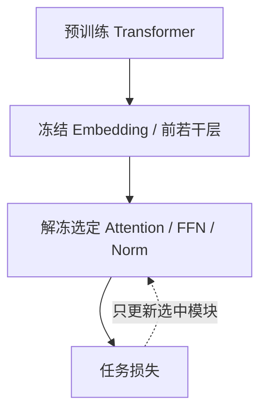
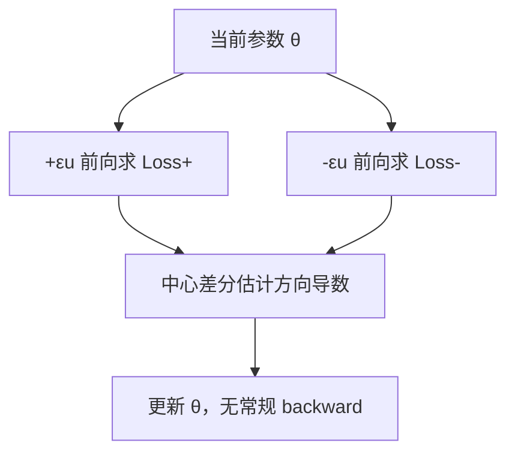
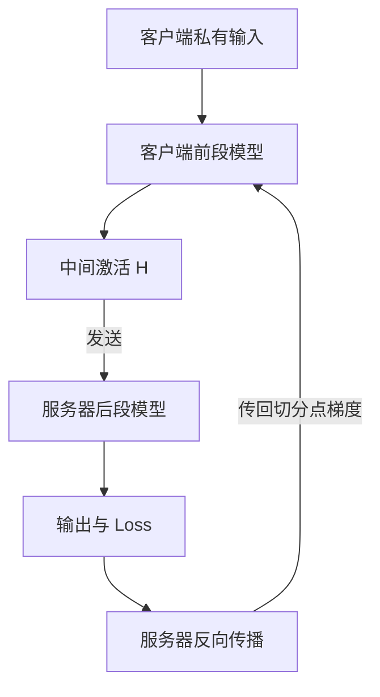

# 第 06 章｜Selective Tuning 与其他高效方法

> [!abstract] 核心结论
> **Selective Tuning** 直接解冻部分原始参数，不增加新模块；零阶优化改变梯度计算方式；分割学习改变计算位置；模型压缩和数据选择减少模型或训练数据负担。它们分属不同维度，可以组合使用。

**导航：** [[05-Adapter微调]] ← 上一章 · 下一章 → [[07-联邦大模型微调]]

## ① 核心原理：选择更新原模型中的哪些参数？

用二值掩码 $M_i\in\{0,1\}$ 说明哪些元素允许更新。简化 SGD 写为：

$$
\boxed{\theta_{t+1}=\theta_t-\eta M\odot\nabla_\theta\mathcal L}
$$

现实实现一般选择性设置 `requires_grad=True`；对于 AdamW 不能把全部优化器行为视为这一个掩码 SGD 公式。

### 1.1 BitFit：只更新 Bias

线性层 $y=Wx+b$，冻结 $W$，训练 $b$。

$$
\frac{\partial\mathcal L}{\partial b}=\frac{\partial\mathcal L}{\partial y}
$$

即便权重方向不变，修改 Bias 仍可移动神经元激活阈值，例如 $\operatorname{ReLU}(wx+b)$。但**许多现代 LLM 的主要线性层没有 Bias**，不能假设所有模型适用。

示例：$W$ 是 $4096\times4096$，$b$ 有 4096 元素，只训练 $b$ 的可训练参数比例约为 $4096/(4096^2+4096)\approx0.0244\%$。

### 1.2 Norm Tuning：只更新归一化层参数

经典 LayerNorm：

$$
\operatorname{LN}(x)=\gamma\odot\frac{x-\mu}{\sqrt{\sigma^2+\epsilon}}+\beta
$$

可仅训练 $\gamma,\beta$ 来改变隐藏表示的缩放和平移。**RMSNorm** 通常只有缩放参数，不能无条件假设存在偏置 $\beta$。

### 1.3 Partial Tuning：按层或模块解冻

例如只训练最后几层、注意力部分投影、FFN 或输出层。方法简单，但如果解冻整个 FFN 或多个 Transformer Block，参数量仍可能非常大。训练后层不一定总优于训练前层，要结合任务验证。



## ② 图解机制：四种其他资源优化方式

| 方法 | 优化对象 | 关键操作 | 限制 |
|---|---|---|---|
| Zeroth-Order | 梯度获取方式 | 通过扰动后的 Loss 差值估计梯度 | 梯度估计噪声高，可能需更多前向计算 |
| Split Learning | 计算部署位置 | 客户端计算前半段，服务器计算后半段 | 激活/梯度通信及信息泄露风险 |
| Compression | 模型大小 | 量化、剪枝、知识蒸馏 | 可能牺牲精度或增加部署复杂度 |
| Data Selection | 训练样本数量 | 筛选代表性数据 | 可能舍弃稀有样本或少数客户端特征 |

### 2.1 零阶优化



代表思路：MeZO 使用仅需前向计算的更新；综述中的 FedKSeed 通过随机种子重建扰动方向，使联邦传输可使用少量数值而非完整梯度。实际通信取决于协议，不能固定声称总是 KB 级。

### 2.2 分割学习



$$
H=f_{\theta_c}(X),\qquad Y=g_{\theta_s}(H)
$$

服务器将 $\partial\mathcal L/\partial H$ 传回客户端。中间激活**可能泄露输入信息**，所以“没上传原始数据”不等于隐私安全。综述提到的 FedBERT 更偏向 BERT 的分布式预训练，不等于通用生成式 LLM SFT。

### 2.3 模型压缩与数据选择

- **Quantization**：以低位宽存储权重（如 QLoRA）；本身不规定可训练参数。
- **Pruning**：删除部分权重/通道/层；结构化剪枝通常更容易产生实际算力收益。
- **Distillation**：教师模型指导较小学生模型。
- **Data Selection**：筛选低冗余、具有代表性的训练样本；综述中的 FedHDS 属于此类。

## ③ 数学与代码

### 3.1 用 PyTorch 只解冻指定参数

```python
import torch
import torch.nn as nn

model = nn.Sequential(
    nn.Linear(128, 128),
    nn.LayerNorm(128),
    nn.Linear(128, 2),
)

for p in model.parameters():
    p.requires_grad = False

# BitFit 例：仅解冻名称结尾为 bias 的参数
for name, p in model.named_parameters():
    if name.endswith("bias"):
        p.requires_grad = True

trainable = [p for p in model.parameters() if p.requires_grad]
optimizer = torch.optim.AdamW(trainable, lr=1e-3)
print("可训练参数:", sum(p.numel() for p in trainable))
```

这里 `LayerNorm.bias` 也可能被解冻；规范 BitFit 实验应明确选择的 Bias 类型。若改做 Norm/Partial Tuning，**应先重置所有参数为冻结，再单独设置**，避免实验条件叠加。

### 3.2 零阶优化完整推导

选随机方向 $u\sim\mathcal N(0,I)$，扰动幅度 $\epsilon$：

$$
\mathcal L_+=\mathcal L(\theta+\epsilon u),\quad
\mathcal L_-=\mathcal L(\theta-\epsilon u)
$$

中心差分方向导数：

$$
d\approx\frac{\mathcal L_+-\mathcal L_-}{2\epsilon}
$$

估计梯度：

$$
\boxed{\widehat g=\frac{\mathcal L_+-\mathcal L_-}{2\epsilon}u}
$$

泰勒展开给出 $d\approx\nabla\mathcal L^\top u$；利用 $\mathbb E[uu^\top]=I$，在平滑条件下，忽略有限差分误差可得 $\mathbb E[\widehat g]\approx\nabla\mathcal L$。**单个方向通常方差大，并非精确梯度。**

```python
import torch

theta = torch.tensor([3.0, -2.0])
target = torch.tensor([1.0, 1.0])

def loss_fn(w):
    return ((w - target) ** 2).sum()

for _ in range(100):
    u = torch.randn_like(theta)
    eps, lr = 1e-3, 0.1
    lp = loss_fn(theta + eps*u)
    lm = loss_fn(theta - eps*u)
    grad_est = ((lp-lm)/(2*eps))*u
    theta = theta - lr*grad_est
print(theta)
```

该示例不需要 `loss.backward()`；但仍需要多次前向计算，不代表大模型上训练速度一定更快。

## ④ 选型与自检

| 需要解决的问题 | 初步考虑 |
|---|---|
| 原模型允许少量原参数调整 | BitFit / Norm / Partial |
| 反向激活显存是主要瓶颈 | Zeroth-Order |
| 客户端不能承载整段模型计算 | Split Learning / 更小模型 |
| 冻结基座权重太大 | 量化 / 压缩 / QLoRA |
| 数据高度重复、训练预算有限 | Data Selection |

> [!tip] 实用首选
> 常规大模型 SFT 仍建议从 [[03-LoRA与QLoRA|LoRA / QLoRA]] 建立基线，再根据明确的瓶颈添加零阶优化、分割或筛选机制。
