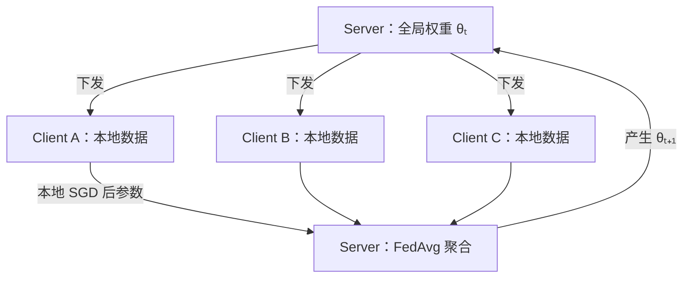
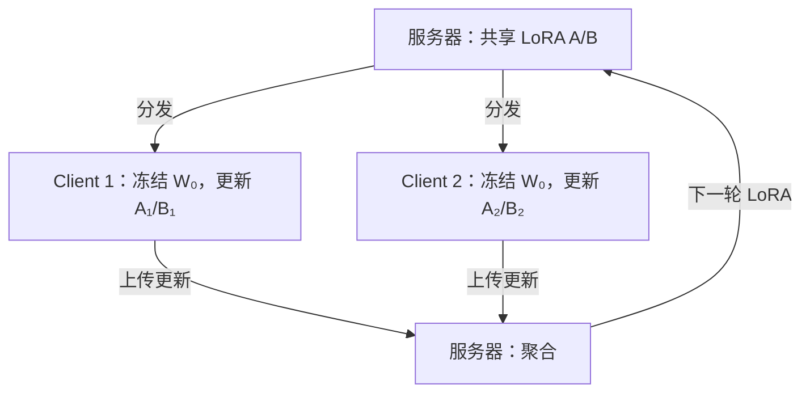
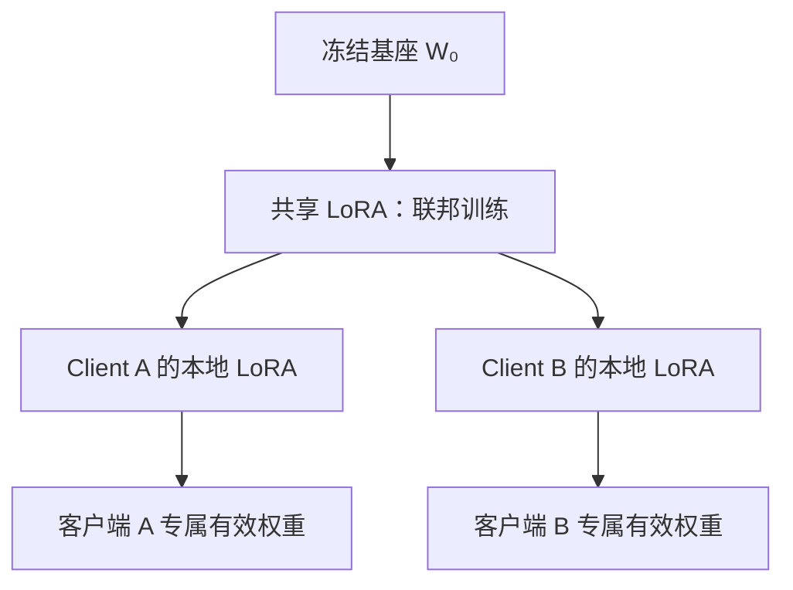

# 第 07 章｜联邦大模型微调（FedLLM）

> [!abstract] 核心结论
> **FedLLM** 让多个客户端使用本地私有数据训练可协作的模型更新，再由服务器聚合。核心难点除了显存与通信，还包括 **Non-IID、客户端资源异构、个性化以及 LoRA 因子聚合的不等价性**。

**导航：** [[06-Selective与其他高效方法]] ← 上一章 · 下一章 → [[08-方法对比与技术选型]] · 先修 [[03-LoRA与QLoRA]]

## ① 核心原理：从 FedAvg 到 FedLoRA

### 1.1 全局目标

客户端 $k$ 有私有数据 $D_k$（样本量 $n_k$），本地损失：

$$
F_k(\theta)=\frac1{n_k}\sum_{i\in D_k}\mathcal L(f_\theta(x_i),y_i)
$$

若按样本量加权，全局经验风险：

$$
\boxed{\min_\theta F(\theta)=\sum_{k=1}^Kp_kF_k(\theta)},\qquad
p_k=\frac{n_k}{\sum_jn_j}
$$

注意：均匀客户端权重、公平目标或个性化目标可以不同，$p_k=n_k/\sum n_j$ 不是所有联邦算法的唯一选择。

### 1.2 FedAvg 轮次

服务器第 $t$ 轮的权重为 $\theta_t$；本轮参与客户端集合为 $S_t$。客户端从共同起点 $\theta_{k,0}=\theta_t$ 出发执行 $E$ 次局部更新：

$$
\theta_{k,e+1}=\theta_{k,e}-\eta\nabla F_k(\theta_{k,e})
$$

服务器加权平均：

$$
\boxed{\theta_{t+1}=\sum_{k\in S_t}\frac{n_k}{\sum_{j\in S_t}n_j}\theta_{k,E}}
$$



> [!warning] FedAvg 不总等价于集中式训练
> 多步本地更新会在不同客户端优化轨迹上行进；通常不等价于在汇总数据上执行同一顺序的集中式 SGD。在共同初始点、各客户端恰好执行一次完整局部梯度计算等特殊条件下，聚合可以等价于一次全局梯度下降。

### 1.3 FedLoRA 的外层流程

每个客户端存储相同/兼容的冻结基座 $W_0$，只训练 LoRA 因子 $A_k,B_k$：

$$
W_k=W_0+sB_kA_k,\quad s=\frac\alpha r
$$



完整基座通常不是每轮都传输，应考虑最初分发及客户端缓存。与 Full Fine-Tuning 相比，FedLoRA 大幅减少需要传输的适配参数，但仍需客户端加载和计算基座。

## ② 图解机制：同构、异构和个性化

### 2.1 Homogeneous LoRA（同构）

所有客户端使用相同 rank $r$、相同目标模块及参数形状；聚合操作较容易实现。代表思路：FedIT 使用 LoRA 与 FedAvg 式协作训练。

### 2.2 Heterogeneous LoRA（异构）

不同客户端按资源使用不同 rank，如 $r_1=4,r_2=8,r_3=16$。

$$
A_1\in\mathbb R^{4\times d},\quad A_2\in\mathbb R^{8\times d}
$$

二者维度不同，**无法直接逐元素平均**。解决思路包括：

- **FLoRA**：拼接不同 rank 因子，保留完整加权权重增量的精确表达，但拼接 rank 增长。
- **FlexLoRA 类**：先聚合权重增量，再以截断 SVD 分配适合各客户端的 rank；截断会产生近似误差。
- **其他异构方法**：通过自剪枝、掩码、动态子网络等实现资源适配。

### 2.3 Personalized LoRA（个性化）

通用思想：共享一部分适配知识，同时保留客户端自己的适配能力。例如：

$$
\boxed{W_k=W_0+\Delta W_g+\Delta W_{p,k}}
$$

- $\Delta W_g$：所有客户端协作得到的共享增量。
- $\Delta W_{p,k}$：客户端 $k$ 保留的个性化增量。



这是解释多种个性化机制的**抽象示例**；不同论文并不必然采用相同的加法结构或优化策略。

## ③ 数学推导：LoRA 因子聚合的关键陷阱

### 3.1 正确目标：平均完整权重增量

先假设两个客户端等权重、缩放 $s=1$：

$$
W_1=W_0+B_1A_1,\qquad W_2=W_0+B_2A_2
$$

希望全局权重增量为：

$$
\boxed{\overline{\Delta W}=\frac12(B_1A_1+B_2A_2)}
$$

**错误直觉：** 先分别平均 A、B 再相乘。

$$
\bar B\bar A=\left(\frac{B_1+B_2}{2}\right)\left(\frac{A_1+A_2}{2}\right)
$$

展开出现 $B_1A_2$、$B_2A_1$ 交叉项：

$$
\bar B\bar A=\frac14(B_1A_1+B_1A_2+B_2A_1+B_2A_2)
$$

差值为：

$$
\boxed{\overline{\Delta W}-\bar B\bar A=\frac14(B_1-B_2)(A_1-A_2)}
$$

一般不为 0。这不是一般意义上的“加权平均有误”，而是**乘法与平均运算不交换**。

### 3.2 极端反例

令 $A_1=B_1=1$；$A_2=B_2=-1$。则两个客户端完整增量都为 1，目标平均也是 1；但 $\bar A=\bar B=0$，从而 $\bar B\bar A=0$，本来完全一致的更新竟被消除。

LoRA 因子表示还不唯一：对于可逆矩阵 $R$，$BA=(BR)(R^{-1}A)$，即相同的 $\Delta W$ 可以有不同参数因子表示。

### 3.3 精确增量聚合：拼接

带权重与缩放时：

$$
\Delta W_g=\sum_{k=1}^Kp_ks_kB_kA_k
$$

构造：

$$
B_c=[p_1s_1B_1,\ldots,p_Ks_KB_K],\qquad
A_c=\begin{bmatrix}A_1\\\vdots\\A_K\end{bmatrix}
$$

于是：

$$
\boxed{B_cA_c=\sum_kp_ks_kB_kA_k}
$$

**拼接表达是精确的**，支持不同 rank；但总 rank 上限变为 $\sum_kr_k$，可能导致参数规模和通信压力增长。FLoRA 是这一类思路的代表研究。

### 3.4 固定 rank：聚合后截断 SVD

若需将高秩结果恢复为 rank $r$，可以：

$$
\Delta W_g=U\Sigma V^\top
$$

保留前 $r$ 个奇异值，得到：

$$
\Delta W_r=U_r\Sigma_rV_r^\top
$$

并可恢复同形状 LoRA 因子，例如在缩放 $s>0$ 时：

$$
B_{new}=U_r\sqrt{\Sigma_r/s},\qquad A_{new}=\sqrt{\Sigma_r/s}V_r^\top
$$

则 $sB_{new}A_{new}=\Delta W_r\approx\Delta W_g$。**这里的近似误差不能忽略。**

相对截断误差：

$$
\boxed{e_r=\frac{\lVert\Delta W_g-\Delta W_r\rVert_F}{\lVert\Delta W_g\rVert_F}}
$$

当原矩阵本身 rank $\le r$ 时可以精确恢复；否则通常有误差。

### 3.5 不构造大矩阵的 QR + 小 SVD

对于 $\Delta W_g=B_cA_c$：

$$
B_c=Q_BR_B,\quad A_c^\top=Q_AR_A
$$

于是：

$$
\Delta W_g=Q_B(R_BR_A^\top)Q_A^\top
$$

只对核心小矩阵 $R_BR_A^\top$ 做 SVD，可以避免直接对完整 $d_{out}\times d_{in}$ 矩阵做大规模 SVD。完整示例见 [[09-完整微调实践]]。

### 3.6 最小矩阵验证代码

```python
import torch

torch.manual_seed(42)
d, r = 8, 2
A1, B1 = torch.randn(r, d), torch.randn(d, r)
A2, B2 = torch.randn(r, d), torch.randn(d, r)

exact = 0.5 * (B1 @ A1) + 0.5 * (B2 @ A2)
naive = ((B1 + B2) / 2) @ ((A1 + A2) / 2)
Bcat = torch.cat([0.5 * B1, 0.5 * B2], dim=1)
Acat = torch.cat([A1, A2], dim=0)
stacked = Bcat @ Acat

print("因子平均误差:", torch.norm(exact - naive).item())
print("拼接聚合误差:", torch.norm(exact - stacked).item())
```

## ④ Non-IID、隐私与自检

### 4.1 Non-IID 与客户端漂移

$P_k(X,Y)\neq P_j(X,Y)$ 时，不同客户端的局部最优可能冲突。例如：

$$
F_1(\theta)=\frac12(\theta-2)^2,\quad F_2(\theta)=\frac12(\theta+2)^2
$$

两客户端最优分别为 2 和 -2，但等权全局最优为 0。多步本地更新会让客户端参数沿各自损失面偏离全局方向，形成 **Client Drift**。

可考虑：

- **FedProx 式近端项**：$F_k(\phi)+\frac\mu2\lVert\phi-\phi_g\rVert^2$，限制本地偏移。
- **个性化分支**：提升各客户端本地适配能力。
- **自适应/鲁棒聚合**：识别分布差异或异常更新。
- **正确的 LoRA 增量聚合**：避免因子平均的代数错误。

> [!important] 两种误差不要混淆
> **Client Drift** 是本地目标不同造成的优化偏移；**LoRA 因子平均误差**是参数表示与聚合运算不等价造成的。一个 FedProx 正则项不能自动解决另一个问题。

### 4.2 隐私边界

数据不上传 ≠ 私有信息不会泄露。更新可能遭受成员推断、梯度/参数反演、模型中毒等攻击。按威胁模型可评估 Secure Aggregation、Differential Privacy、鲁棒聚合和运行时安全；这些机制有性能与系统代价。

### 4.3 代表性方法阅读优先级

| 方法 | 应掌握什么 |
|---|---|
| FedIT | LoRA + FedAvg 基线 |
| FedSA-LoRA | 共享 A、保留本地 B 的个性化思想 |
| FLoRA | 拼接因子，精确表达权重增量聚合 |
| FlexLoRA | 聚合更新后 SVD 适配异构 rank |
