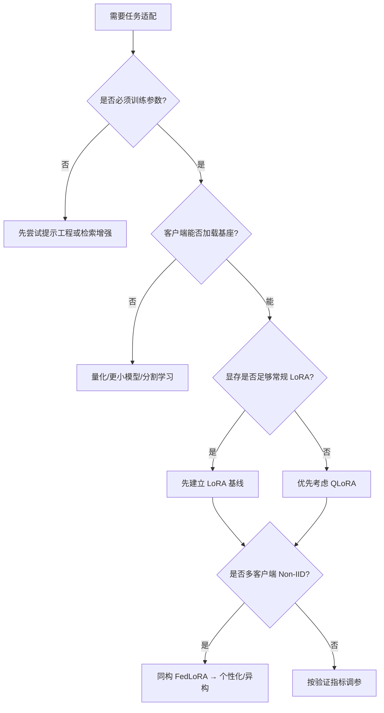

# 第 08 章｜微调方法对比与技术选型

> [!abstract] 核心结论
> **常规资源受限 SFT 优先建立 LoRA 基线；显存不足优先考虑 QLoRA。** 选型必须同时比较**任务质量、显存、吞吐量、通信量与可训练参数**，不存在跨任务、跨硬件的普遍最优方法。

**导航：** [[07-联邦大模型微调]] ← 上一章 · 下一章 → [[09-完整微调实践]]

## ① 核心原理：比较维度不能混为一谈

| 方法 | 优化对象 | 主要优势 | 核心代价 |
|---|---|---|---|
| Full Fine-Tuning | 全部模型参数 | 参数自由度最高 | 优化器状态、显存、通信大 |
| LoRA | A、B 低秩因子 | 性能/资源/工程的实用平衡 | 更新空间受 rank 约束 |
| QLoRA | 4-bit 冻结基座 + LoRA | 权重显存较低 | 量化误差与额外计算 |
| Prompt Tuning | 输入 Soft Prompt | 可训练参数和参数通信极低 | 提示长度和适配能力受限 |
| Prefix Tuning | 多层 K/V Prefix | 深层控制 Attention | 较多前缀和注意力计算 |
| Adapter | 插入瓶颈网络 | 模块化、可非线性适配 | 常增加推理模块开销 |
| Selective | 原模型指定子集 | 不需新增模块 | 参数选择和任务匹配困难 |

### 1.1 四个成本指标

训练参数：

$$
P_{train}=\sum_{p:\,requires\_grad}\operatorname{numel}(p)
$$

训练显存：

$$
M_{peak}\approx M_{weights}+M_{grad}+M_{optimizer}+M_{activation}+M_{extra}
$$

训练总时间：

$$
T_{train}\approx N_{steps}\times t_{step}
$$

通信量：

$$
C_{total}=\sum_{t=1}^T(C_{up,t}+C_{down,t})
$$

> [!warning] 错误推理
> $P_{train}$ 减少 99% **不意味着** GPU 峰值显存、FLOPs 或训练时间也减少 99%。基座仍执行前向与相关反向计算；Prompt 还可能增大有效上下文长度。

## ② 示意与计算：统一假设下的理论参数量

为公平比较，明确设定一个**教学假设**：隐藏维度 $d=4096$，Transformer 层数 $L=32$，LoRA rank=8，仅给 Q/V 两个 $4096\times4096$ 层注入；Prompt 长度 $m=20$；Adapter 每层一个，瓶颈 $r_a=16$。这不是特定 7B 架构实测数据。

- **LoRA 参数量：** $L\times2\times 2dr=32\times2\times2\times4096\times8=4,194,304$。
- **Prompt 参数量：** $md=20\times4096=81,920$。
- **Adapter 参数量：** $L(2dr_a)=32\times2\times4096\times16=4,194,304$（不计 bias）。

| 方法 | 可训练参数 | BF16 理论上传量（单客户端单轮） |
|---|---:|---:|
| Full（假设 7B） | 7,000,000,000 | 约 14GB |
| LoRA（本例） | 4,194,304 | 约 8.39MB |
| Prompt（本例） | 81,920 | 约 0.164MB |
| Adapter（本例） | 4,194,304 | 约 8.39MB |

所有数值均为**上传密集参数**的简化估算，不包含网络协议、压缩、初始化、重复下载及真实设备环境。

### 2.1 QLoRA 仅能简单估算基座存储

7B 参数使用 BF16 约 $7\times10^9\times2=14$GB；按 4-bit 理想存储约 $7\times10^9\times0.5=3.5$GB。后者**不是训练显存**，还要加量化元数据、激活、LoRA、缓存和其他状态。不能由此推断 4GB 显卡必然能训练 7B 模型。

## ③ 技术选型：先看瓶颈，再验证



> [!note] 流程不是算法定理
> 对外部知识查询，RAG/工具检索有时优于微调；但是否需要训练，要根据任务实际要求判定。本图体现**初始技术路线**而非对所有任务的唯一解。

### 3.1 典型场景首选方案

| 场景 | 首选/先做什么 | 为什么 |
|---|---|---|
| 普通指令 SFT，硬件一般 | **LoRA** | 成熟、参数效率与性能折中合理 |
| 显存紧张 | **QLoRA** | 减少冻结基座存储 |
| 通信极紧张、任务较简单 | Prompt Tuning | 需交换的提示参数少 |
| 多任务独立适配模块 | LoRA；必要时比较 Adapter | 模块可以独立保存与切换 |
| 非 IID 联邦数据 | 同构 FedLoRA 基线→个性化方法 | 对照全局与本地表现 |
| 客户端加载不了基座 | 小模型/量化/模型切分 | 单靠缩小 rank 不解决基座驻留 |

### 3.2 真实参数量检查

```python
def parameter_report(model):
    total = sum(p.numel() for p in model.parameters())
    trainable = sum(p.numel() for p in model.parameters() if p.requires_grad)
    print(f"total={total:,}, trainable={trainable:,}, pct={trainable/total:.4%}")
```

对于量化模型，`numel()` 不一定与原始参数一一对应，也不能用它代替显存实测。

### 3.3 CUDA 峰值显存检查

```python
import torch

torch.cuda.synchronize()
torch.cuda.reset_peak_memory_stats()
optimizer.zero_grad(set_to_none=True)
loss = model(**batch).loss
loss.backward()
optimizer.step()
torch.cuda.synchronize()
peak_allocated_gib = torch.cuda.max_memory_allocated() / 1024**3
peak_reserved_gib = torch.cuda.max_memory_reserved() / 1024**3
print(peak_allocated_gib, peak_reserved_gib)
```

`max_memory_allocated` 只统计 PyTorch 分配的 GPU 显存；还可通过 GPU 系统工具观测整卡占用。训练吞吐量推荐报告 Tokens/s；比较训练成本时可同时报告**同样 Token 预算**与**同样时间预算**。

## ④ 受控实验与自检

### 4.1 最小对比实验

| 实验 | 作用 |
|---|---|
| 原始模型（不微调） | 任务能力基线 |
| LoRA | PEFT 基线 |
| QLoRA | 显存、速度及量化影响 |
| FFT（预算允许） | 更高自由度参考，不是假设的性能上界 |

控制基座模型、数据拆分、测评方式与随机种子；记录 LoRA rank、target modules、Batch、学习率、训练步数与量化配置。不同方法可以各自合理调参，但应**报告超参数搜索预算**。

需要报告：

- **效果**：Accuracy/F1 或生成任务专项指标、验证/测试集 Loss。
- **资源**：可训练参数数目、峰值 GPU 显存、Tokens/s、训练时间、保存文件体积。
- **联邦额外指标**：每轮/总通信字节、全局与客户端平均性能、低分位客户端性能、收敛轮数和聚合近似误差。

> [!important] 不要把 Loss 当成最终任务效果
> 小训练集上的 Loss 下降只证明局部拟合；泛化性能须在独立测试集上评估，尽可能重复多个随机种子。
