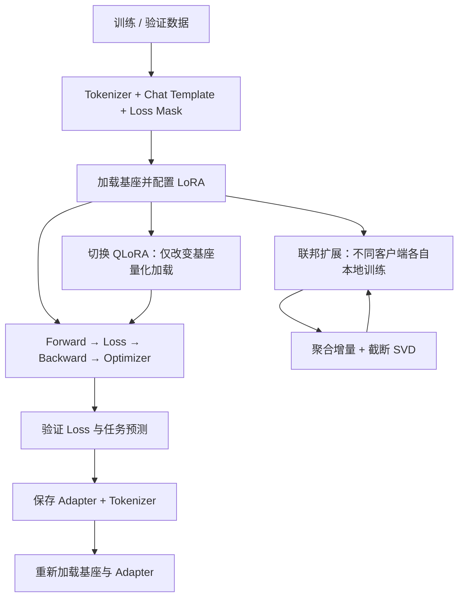

# 第 09 章｜完整微调实践：LoRA → QLoRA → FedLoRA

> [!abstract] 核心结论
> 最小可复现路线：**先跑通单机 LoRA 的数据—训练—验证—保存—重载闭环，再切换为 QLoRA，最后模拟多客户端训练和 LoRA 聚合。** 不要在尚未验证单机代码时同时引入量化、异构 rank 和联邦机制。

**导航：** [[08-方法对比与技术选型]] ← 上一章 · 核心原理回顾：[[01-大模型微调基础]] · [[03-LoRA与QLoRA]] · [[07-联邦大模型微调]]

## ① 核心原理：实验设置与训练目标

### 1.1 教学实验配置

| 项目 | 教学配置 |
|---|---|
| 基座 | `Qwen/Qwen2.5-0.5B-Instruct` |
| 任务 | 中文短文本二分类（积极 / 消极） |
| 数据量 | 8 条训练 + 2 条验证，**只用于 Smoke Test** |
| 单机 LoRA | rank=8、alpha=16，Q/V 投影 |
| QLoRA | NF4 4-bit、double quant、BF16 计算 |
| 联邦模拟 | 2 个客户端，强 Non-IID 划分，顺序本地训练 |
| 聚合 | 完整增量加权聚合 → 截断 SVD 恢复 rank |
| 技术栈 | Python、PyTorch、Transformers、PEFT、bitsandbytes |

> [!warning] 结果适用范围
> 10 条演示数据**不足以检验泛化性能**。训练 Loss 下降不等于微调改善了任务效果；联邦模拟不包含真实客户端隔离、网络通信、安全聚合或隐私保证。

### 1.2 为什么只对回答计算 SFT Loss？

数据示例：

- User: `判断下列文本情感，只回答积极或消极：这款耳机声音清晰。`
- Assistant: `积极`

构造完整 Chat Template 后，对提示词部分设 `labels=-100`，仅监督 assistant 回答及合适的终止 Token。因果语言模型内部处理 next-token shift：

$$
\mathcal L=-\sum_{t\in\text{assistant answer}}\log p_\theta(x_t\mid x_{<t})
$$

`-100` 并不删除指令，模型仍可以通过 Attention 使用这些 Token。

## ② 图解机制：三阶段训练闭环



**三种实验并不需要三套完全独立的数据处理代码**：相同的训练数据与标签逻辑可复用；区别在基座加载方式及联邦外循环。

### 2.1 环境准备

```bash
python -m pip install -U torch transformers peft accelerate bitsandbytes safetensors
```

需要联网下载 Hugging Face 模型。普通 LoRA 可以在 CPU 上尝试（较慢）；本章 QLoRA 示例明确要求支持 BF16 的 NVIDIA CUDA GPU。第三方库持续更新，运行前须检查兼容性。

建议命令（见本笔记末尾的**完整源码附录**）：

```bash
python lora_train.py --mode lora
python lora_train.py --mode qlora
python fed_lora_demo.py
```

> [!tip] 把附录代码保存为文件
> 本文末尾附上 `lora_train.py` 与 `fed_lora_demo.py` 的完整源代码块。将各代码块复制到同一目录，以文件名保存后运行。Obsidian Markdown 本身不执行 Python。

## ③ 数学与代码：三个实验分别验证什么？

### 3.1 实验 A：单机 LoRA

核心模型配置：

```python
from peft import LoraConfig, get_peft_model

config = LoraConfig(
    task_type="CAUSAL_LM",
    r=8,
    lora_alpha=16,
    target_modules=["q_proj", "v_proj"],
    lora_dropout=0.0,
    bias="none",
)
model = get_peft_model(base_model, config)
model.print_trainable_parameters()
```

对应：

$$
W_{eff}=W_0+\frac{16}{8}BA=W_0+2BA
$$

典型训练步：

```python
optimizer.zero_grad(set_to_none=True)
out = model(**batch)
loss = out.loss
loss.backward()
optimizer.step()
```

要依次验证：

1. 是否只有 LoRA 参数 `requires_grad=True`。
2. `loss` 是否有限（不是 `NaN`/`Inf`）。
3. 验证集 Loss 是否可在训练前、后分别计算。
4. 能否调用 `generate()`。
5. 能否通过 `save_pretrained()` 保存 Adapter，并在同一基座上用 `PeftModel.from_pretrained()` 重新加载。

**保存的 Adapter 通常不是完整基座模型文件**，部署时还需要加载匹配的预训练模型。

### 3.2 实验 B：QLoRA

只替换基座加载过程：

```python
from transformers import BitsAndBytesConfig, AutoModelForCausalLM
from peft import prepare_model_for_kbit_training

qconf = BitsAndBytesConfig(
    load_in_4bit=True,
    bnb_4bit_quant_type="nf4",
    bnb_4bit_use_double_quant=True,
    bnb_4bit_compute_dtype=torch.bfloat16,
)
base = AutoModelForCausalLM.from_pretrained(
    "Qwen/Qwen2.5-0.5B-Instruct",
    quantization_config=qconf,
    device_map={"": 0},
    dtype=torch.bfloat16,
)
base = prepare_model_for_kbit_training(base)
```

再套用同一套 LoRA 配置与训练循环。重点测量**峰值显存、训练吞吐量、验证 Loss**，而不只是训练 Loss。量化基座不意味着全部计算都在 4-bit 上完成。

### 3.3 实验 C：两客户端 FedLoRA

客户端 A 只得到积极样本，客户端 B 只得到消极样本，刻意模拟强 Non-IID。

一次通信轮次：

1. 两个客户端从**同一轮全局 LoRA 参数**开始（不能让 B 接着 A 的更新直接训练）。
2. 各自局部训练 1 Epoch，并保存对应 A/B 因子。
3. 对每层加权求**完整有效增量** $\sum_kp_ksB_kA_k$。
4. 利用拼接表示精确构造增量，再以 QR + 小矩阵 SVD 截断回 rank=8。
5. 下发新的全局 LoRA，进入下一轮。

> [!important] 精确 vs 近似
> **加权增量拼接是精确恒等式**；**从总 rank 截断回固定 rank=8 是近似**。必须报告近似误差。

### 3.4 为什么使用 QR + SVD？

先拼接：

$$
B_c=[p_1sB_1,\ldots,p_KsB_K],\qquad A_c=[A_1^\top,\ldots,A_K^\top]^\top
$$

于是 $\Delta W_g=B_cA_c$。对因子作 thin QR：

$$
B_c=Q_BR_B,\qquad A_c^\top=Q_AR_A
$$

得到：

$$
\boxed{\Delta W_g=Q_B(R_BR_A^\top)Q_A^\top}
$$

只对较小的核心矩阵 $R_BR_A^\top$ 做 SVD，就可恢复 rank=$r$ 的近似；当总 rank 远小于原矩阵维度时能避免完整密集大矩阵 SVD。

截断误差：

$$
e_r=\frac{\lVert\Delta W_g-\Delta W_r\rVert_F}{\lVert\Delta W_g\rVert_F}
$$

它衡量矩阵近似的信息损失，**不是模型在测试集上的错误率**。

## ④ 实验测量、排错与自检

### 4.1 必须记录的指标

| 指标 | 单机 LoRA | QLoRA | FedLoRA |
|---|:---:|:---:|:---:|
| 可训练参数数目 | ✓ | ✓ | ✓ |
| 验证 Loss / Accuracy | ✓ | ✓ | ✓ |
| 训练时间 / Tokens/s | ✓ | ✓ | ✓ |
| GPU 峰值显存 | ✓ | ✓ | ✓ |
| 总通信字节数 | — | — | ✓ |
| 聚合相对截断误差 | — | — | ✓ |

对于真实研究还需要独立测试集、多随机种子、各客户端任务性能和少数客户端表现，不能仅从 8 条教学训练样本推断算法优劣。

### 4.2 常见错误排查

| 现象 | 优先检查 |
|---|---|
| OOM | 模型能否加载、Batch、上下文、量化方式 |
| Loss NaN | `labels` 是否含有效答案、学习率、计算精度 |
| Loss 不变化 | Adapter 是否可训练、梯度是否非零、答案 Mask 是否正确 |
| 输出格式不对 | Chat Template、生成终止条件、样本质量 |
| FedLoRA 训练退化 | 所有客户端是否共用轮次初始权重、Non-IID、局部训练量、截断误差 |
| 保存后无法加载 | 是否使用相同基座、匹配的 PEFT 配置 |


> [!success] 九章学习闭环
> 课程链路：[[01-大模型微调基础]] → [[02-全量微调]] → [[03-LoRA与QLoRA]] → [[04-Prompt-based微调]] → [[05-Adapter微调]] → [[06-Selective与其他高效方法]] → [[07-联邦大模型微调]] → [[08-方法对比与技术选型]] → [[09-完整微调实践]]。

---

## 附录 A：`lora_train.py` 完整脚本

> [!note] 用途与边界
> 以下为教学脚本源码；需要匹配的 Python 依赖以及 Hugging Face 模型下载，未在本笔记生成环境执行端到端 GPU 训练。样本规模极小，只适合流程验证。

```python
"""Chapter 9: reproducible LoRA / QLoRA instructional SFT smoke test.

Run:
  python lora_train.py --mode lora
  python lora_train.py --mode qlora  # CUDA GPU with BF16 support

Tiny synthetic examples are for workflow validation, not accuracy claims.
"""
import argparse
import random
from pathlib import Path

import torch
from torch.utils.data import DataLoader
from transformers import AutoModelForCausalLM, AutoTokenizer, BitsAndBytesConfig
from peft import (
    LoraConfig, PeftModel, get_peft_model,
    prepare_model_for_kbit_training,
)

MODEL_ID = "Qwen/Qwen2.5-0.5B-Instruct"

TRAIN = [
    ("这款耳机声音清晰，佩戴也舒适。", "积极"),
    ("服务员很有耐心，体验不错。", "积极"),
    ("包装完好，配送速度很快。", "积极"),
    ("系统操作流畅，功能实用。", "积极"),
    ("产品有明显划痕，还不能正常使用。", "消极"),
    ("等待时间过长，服务态度不好。", "消极"),
    ("软件经常崩溃，令人失望。", "消极"),
    ("商品迟迟不发货，沟通无果。", "消极"),
]
VALID = [
    ("音质很好，续航时间也很长。", "积极"),
    ("质量很差，没用多久就坏了。", "消极"),
]


def task_prompt(sentence):
    return f"判断下列文本情感，只回答积极或消极：{sentence}"


def encode_example(tokenizer, item):
    sentence, answer = item
    user = {"role": "user", "content": task_prompt(sentence)}
    assistant = {"role": "assistant", "content": answer}
    prompt_ids = tokenizer.apply_chat_template(
        [user], tokenize=True, add_generation_prompt=True
    )
    complete_ids = tokenizer.apply_chat_template(
        [user, assistant], tokenize=True, add_generation_prompt=False
    )
    if complete_ids[:len(prompt_ids)] != prompt_ids:
        raise ValueError("Chat template prefix mismatch; check tokenizer/template")
    if len(complete_ids) <= len(prompt_ids):
        raise ValueError("No assistant target tokens in this sample")
    labels = [-100] * len(prompt_ids) + complete_ids[len(prompt_ids):]
    return {"input_ids": complete_ids, "labels": labels}


def make_loader(tokenizer, records, *, batch_size=2, shuffle=False):
    encoded = [encode_example(tokenizer, item) for item in records]

    def collate(examples):
        max_len = max(len(ex["input_ids"]) for ex in examples)
        pad_id = tokenizer.pad_token_id
        return {
            "input_ids": torch.tensor(
                [ex["input_ids"] + [pad_id] * (max_len - len(ex["input_ids"]))
                 for ex in examples], dtype=torch.long
            ),
            "labels": torch.tensor(
                [ex["labels"] + [-100] * (max_len - len(ex["labels"]))
                 for ex in examples], dtype=torch.long
            ),
            "attention_mask": torch.tensor(
                [[1] * len(ex["input_ids"]) + [0] * (max_len - len(ex["input_ids"]))
                 for ex in examples], dtype=torch.long
            ),
        }

    return DataLoader(encoded, batch_size=batch_size, shuffle=shuffle, collate_fn=collate)


def load_base(mode):
    if mode == "qlora":
        if not torch.cuda.is_available() or not torch.cuda.is_bf16_supported():
            raise RuntimeError("This instructional QLoRA example requires a CUDA GPU with BF16 support")
        qconf = BitsAndBytesConfig(
            load_in_4bit=True,
            bnb_4bit_quant_type="nf4",
            bnb_4bit_use_double_quant=True,
            bnb_4bit_compute_dtype=torch.bfloat16,
        )
        base = AutoModelForCausalLM.from_pretrained(
            MODEL_ID, quantization_config=qconf, device_map={"": 0}, dtype=torch.bfloat16
        )
        return prepare_model_for_kbit_training(base)

    dtype = torch.bfloat16 if torch.cuda.is_available() and torch.cuda.is_bf16_supported() else torch.float32
    base = AutoModelForCausalLM.from_pretrained(MODEL_ID, dtype=dtype)
    return base.to("cuda" if torch.cuda.is_available() else "cpu")


def build_model(mode="lora"):
    base = load_base(mode)
    config = LoraConfig(
        task_type="CAUSAL_LM", r=8, lora_alpha=16,
        target_modules=["q_proj", "v_proj"],
        lora_dropout=0.0, bias="none"
    )
    return get_peft_model(base, config)


def model_device(model):
    return model.get_input_embeddings().weight.device


def to_device(batch, model):
    return {k: v.to(model_device(model)) for k, v in batch.items()}


def fit(model, loader, *, epochs=2, lr=2e-4):
    optimizer = torch.optim.AdamW(
        (p for p in model.parameters() if p.requires_grad), lr=lr
    )
    latest_loss = float("nan")
    for epoch in range(epochs):
        model.train()
        for batch in loader:
            optimizer.zero_grad(set_to_none=True)
            loss = model(**to_device(batch, model)).loss
            if not torch.isfinite(loss):
                raise RuntimeError("Non-finite loss; inspect labels and precision")
            loss.backward()
            torch.nn.utils.clip_grad_norm_(
                (p for p in model.parameters() if p.requires_grad), 1.0
            )
            optimizer.step()
            latest_loss = loss.item()
        print(f"epoch {epoch + 1}: final batch loss = {latest_loss:.4f}")
    return latest_loss


@torch.no_grad()
def validation_loss(model, loader):
    model.eval()
    losses = []
    for batch in loader:
        loss = model(**to_device(batch, model)).loss
        losses.append(loss.item())
    return sum(losses) / len(losses)


@torch.no_grad()
def predict(model, tokenizer, sentence):
    model.eval()
    ids = tokenizer.apply_chat_template(
        [{"role": "user", "content": task_prompt(sentence)}],
        tokenize=True, add_generation_prompt=True, return_tensors="pt"
    ).to(model_device(model))
    output = model.generate(
        input_ids=ids, max_new_tokens=12, do_sample=False,
        pad_token_id=tokenizer.pad_token_id
    )
    return tokenizer.decode(output[0, ids.shape[1]:], skip_special_tokens=True).strip()


def main():
    parser = argparse.ArgumentParser()
    parser.add_argument("--mode", choices=["lora", "qlora"], default="lora")
    parser.add_argument("--epochs", type=int, default=3)
    args = parser.parse_args()

    random.seed(42)
    torch.manual_seed(42)
    tokenizer = AutoTokenizer.from_pretrained(MODEL_ID)
    if tokenizer.pad_token_id is None:
        tokenizer.pad_token = tokenizer.eos_token

    model = build_model(args.mode)
    model.print_trainable_parameters()
    train_loader = make_loader(tokenizer, TRAIN, shuffle=True)
    val_loader = make_loader(tokenizer, VALID)

    print("Before, val loss:", round(validation_loss(model, val_loader), 4))
    fit(model, train_loader, epochs=args.epochs)
    print("After, val loss:", round(validation_loss(model, val_loader), 4))
    print("Generation:", predict(model, tokenizer, VALID[0][0]))

    output_dir = Path(f"output_{args.mode}_adapter")
    model.save_pretrained(output_dir)
    tokenizer.save_pretrained(output_dir)
    print("Saved:", output_dir)

    # Demonstrate adapter reload: same base model, separate saved LoRA weights.
    del model
    if torch.cuda.is_available():
        torch.cuda.empty_cache()
    base_again = load_base(args.mode)
    reloaded = PeftModel.from_pretrained(base_again, output_dir)
    print("Reloaded generation:", predict(reloaded, tokenizer, VALID[0][0]))


if __name__ == "__main__":
    main()
```

## 附录 B：`fed_lora_demo.py` 完整脚本

> [!warning] 仿真范围
> 这是单进程顺序模拟，不实现真实网络、安全聚合、DP 或多客户端隔离。

```python
"""Chapter 9: two-client sequential FL simulation with low-rank QR/SVD aggregation.

Run: python fed_lora_demo.py

Educational single-process simulation. No privacy protocol, no networking,
no model-pooling system, and no convergence guarantees.
"""
import torch
from transformers import AutoTokenizer
from peft.tuners.lora import LoraLayer
from lora_train import (
    MODEL_ID, TRAIN, VALID, build_model, make_loader,
    fit, validation_loss,
)


def lora_layers(model):
    return {
        name: layer for name, layer in model.named_modules()
        if isinstance(layer, LoraLayer)
        and "default" in layer.lora_A and "default" in layer.lora_B
    }


@torch.no_grad()
def capture(model):
    """Capture LoRA A/B parameters on CPU (float32) by module name."""
    return {
        name: (
            layer.lora_A["default"].weight.detach().cpu().float().clone(),
            layer.lora_B["default"].weight.detach().cpu().float().clone(),
        )
        for name, layer in lora_layers(model).items()
    }


@torch.no_grad()
def restore(model, state):
    layers = lora_layers(model)
    if set(layers) != set(state):
        raise ValueError("LoRA module mismatch")
    for name, layer in layers.items():
        A, B = state[name]
        dest_A = layer.lora_A["default"].weight
        dest_B = layer.lora_B["default"].weight
        dest_A.copy_(A.to(device=dest_A.device, dtype=dest_A.dtype))
        dest_B.copy_(B.to(device=dest_B.device, dtype=dest_B.dtype))


@torch.no_grad()
def weighted_delta_then_low_rank(model, local_states, weights):
    """Average effective LoRA increments then rank-r truncate using small QR+SVD.

    For each layer s*B*A, computes exactly sum_k p_k*s*B_k*A_k
    before projecting it back into original LoRA rank r.
    Avoids a large dense d_out x d_in SVD.
    """
    if abs(sum(weights) - 1.0) > 1e-6:
        raise ValueError("Client weights should sum to 1")
    aggregated = {}
    errors = []
    for name, layer in lora_layers(model).items():
        scale = float(layer.scaling["default"])
        rank = layer.lora_A["default"].weight.shape[0]

        # Concatenation exactly represents the mean effective update.
        Bs = [w * scale * state[name][1] for w, state in zip(weights, local_states)]
        As = [state[name][0] for state in local_states]
        Bcat = torch.cat(Bs, dim=1)
        Acat = torch.cat(As, dim=0)

        # Thin QR compresses the big matrices to a tiny core (clients*rank)^2.
        Qb, Rb = torch.linalg.qr(Bcat, mode="reduced")
        Qa, Ra = torch.linalg.qr(Acat.T, mode="reduced")
        U, S, Vh = torch.linalg.svd(Rb @ Ra.T, full_matrices=False)

        # Best rank-r approximation of the *mean effective update*.
        root = torch.sqrt(torch.clamp(S[:rank] / scale, min=0))
        B_new = (Qb @ U[:, :rank]) * root[None, :]
        A_new = root[:, None] * (Vh[:rank, :] @ Qa.T)
        aggregated[name] = (A_new.contiguous(), B_new.contiguous())

        # Relative Frobenius truncation error, derived from singular values.
        ratio = (torch.linalg.vector_norm(S[rank:]) /
                 torch.linalg.vector_norm(S).clamp_min(1e-12))
        errors.append(float(ratio))
    return aggregated, sum(errors) / len(errors)


def main():
    torch.manual_seed(42)
    tokenizer = AutoTokenizer.from_pretrained(MODEL_ID)
    if tokenizer.pad_token_id is None:
        tokenizer.pad_token = tokenizer.eos_token
    model = build_model("lora")
    model.print_trainable_parameters()

    clients = [TRAIN[:4], TRAIN[4:]]  # Strongly Non-IID toy split
    weights = [len(c) / len(TRAIN) for c in clients]
    val_loader = make_loader(tokenizer, VALID)
    global_state = capture(model)
    print("Initial val loss:", round(validation_loss(model, val_loader), 4))

    for round_index in range(2):
        local_states = []
        for k, client_examples in enumerate(clients):
            # Every client starts from the same global LoRA state.
            restore(model, global_state)
            loader = make_loader(tokenizer, client_examples, shuffle=True)
            print(f"Round {round_index + 1}, client {k + 1}")
            fit(model, loader, epochs=1)
            local_states.append(capture(model))

        global_state, approx_err = weighted_delta_then_low_rank(
            model, local_states, weights
        )
        restore(model, global_state)
        print(f"Round {round_index + 1}, mean relative truncation error: {approx_err:.6f}")
        print("Global val loss:", round(validation_loss(model, val_loader), 4))

    model.save_pretrained("output_fed_lora_adapter")
    tokenizer.save_pretrained("output_fed_lora_adapter")
    print("Saved: output_fed_lora_adapter")


if __name__ == "__main__":
    main()
```

