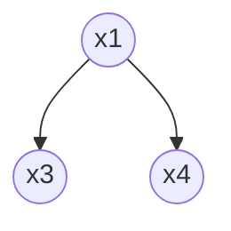
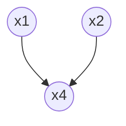

## 1. 贝叶斯决策论

### 条件风险

基于后验概率 $P(c_i | x)$，将样本 $x$ 分类为 $c_i$ 产生的**期望损失**
$$R(c_i | x) = \sum_{j=1}^{N}\lambda_{ij} P(c_j | x)$$
- $\lambda_{ij}$为将一个真实标记为$c_j$的样本误分类为$c_i$所产生的损失

### 贝叶斯判定准则

为**最小化总体风险**，对每个样本选择能使条件风险$R(c | x)$最小的类别标记
$$h^*(x) = \arg\min_{c \in \mathcal{Y}} R(c | x)$$
- $h^*$ 称为**贝叶斯最优分类器
- 总体风险$R(h^*)$称为**贝叶斯风险**
- $1 - R(h^*)$ 是分类器所能达到的最好性能

### 判别式与生成式模型

- **判别式模型**：给定x，通过直接建模$P(c | x)$来预测c
- **生成式模型**：先对联合分布 $P(x, c)$ 建模，再推 $P(c | x)$

### 贝叶斯定理

$$P(c|x) = \frac{P(c) \cdot P(x|c)}{P(x)}$$
- $P(c)$：**先验概率**
- $P(x|c)$：样本x相对与类标记c的类**条件概率**，也成为“**似然**”
- $P(x)$：用于归一化的“**证据**”因子
- $P(c|x)$：**后验概论**

---

## 2. 极大似然估计

>参数取值应使观察到的数据出现概率最大

假设 $D_c$ 表示训练集 $D$ 中第 $c$ 类样本组成的集合，且这些样本是**独立同分布**的。对于参数 $\theta_c$，其在数据集 $D_c$ 上的似然为
$$P(D_c \mid \theta_c) = \prod_{x \in D_c} P(x \mid \theta_c)$$
**对数似然**，防止下溢

$$LL(\theta_c) = \log P(D_c \mid \theta_c) = \sum_{x \in D_c} \log P(x \mid \theta_c)$$

参数 $\theta_c$ 的**极大似然估计值** $\hat{\theta}_c$ 为

$$\hat{\theta}_c = \arg \max_{\theta_c} LL(\theta_c)$$

---

## 3. 朴素贝叶斯分类器

### 属性条件独立性假设

属性条件独立性假设： **对已知类别，假设所有属性相互独立**
$$P(c \mid \boldsymbol{x}) = \frac{P(c) P(\boldsymbol{x} \mid c)}{P(\boldsymbol{x})} = \frac{P(c)}{P(\boldsymbol{x})} \prod_{i=1}^{d} P(x_i \mid c)$$
**贝叶斯判定准则**为：
$$h_{nb}(\boldsymbol{x}) = \arg \max_{c \in \mathcal{Y}} P(c) \prod_{i=1}^{d} P(x_i \mid c)$$
- $P(c)$ 为**类先验概率**。
- $\prod_{i=1}^{d} P(x_i \mid c)$ 为基于属性条件独立性假设的**类条件概率**。

### 参数估计

**先验概率：** 
$$P(c) = \frac{|D_c|}{|D|}$$
**离散属性条件概率：**
$$P(x_i|c) = \frac{|D_{c,x_i}|}{|D_c|}$$
- $D_{c,x_i}$为$D_c$中在第$i$个属性上取值为$x_i$的样本的集合

**连续属性条件概率：** 考虑概率密度函数，比如服从高斯分布$p(x_i|c) \sim \mathcal{N}(\mu_{c,i}, \sigma_{c,i}^2)$，则
$$p(x_i | c) = \frac{1}{\sqrt{2\pi}\sigma_{c,i}} \exp\left( -\frac{(x_i - \mu_{c,i})^2}{2\sigma_{c,i}^2} \right)$$

### 拉普拉斯修正

避免因训练集样本不充分而导致概率估值为零
$$\hat{P}(c) = \frac{|D_c| + 1}{|D| + N}$$
$$\hat{P}(x_i | c) = \frac{|D_{c,x_i}| + 1}{|D_c| + N_i}$$
- $N$ = 类别数，$N_i$ = 属性 $i$ 的取值数
- **当训练集变大时，修正影响可忽略**

---

## 4. 半朴素贝叶斯分类器

> 适当考虑一部分属性间的相互**依赖信息**

### 独依赖估计（ODE）

假设每个属性在类别之外**最多仅依赖于一个其他属性**
$$P(c | x) \propto P(c) \prod_{i=1}^{d} P(x_i | c, pa_i)$$
- $pa_i$ 是属性 $x_i$ 所依赖的属性，称为“**父属性**”

### 三种经典类型

- **SPODE**
	- 假设**所有属性都依赖于同一个属性**
	- 通过交叉验证确定超父属性
- **TAN**
	- 基于**最大带权生成树**
	- 仅保留了强相关属性之间的依赖性
- **AODE**
	- 基于集成学习机制
	- 将**每个属性都当成一次父属性进行SPODE**，将具有最够多训练数据的SPODE**集成**起来作为最后结果

---

## 5. 贝叶斯网

借助**有向无环图**来刻画属性之间的依赖关系

一个贝叶斯网B由 结构G 和 参数 Θ 组成，B=<G , Θ>
- **结构 G**：有向无环图，节点 = 属性，边 = 直接依赖
- **参数 Θ**：每个节点的**条件概率表 (CPT)** $\theta_{x_i \mid \pi_i} = P_B(x_i \mid \pi_i)$

### 三种典型依赖关系

#### 同父

- 给定父节点$x_1$的取值，$x_3$和$x_4$条件独立
#### 顺序

- 给定$x$的取值，$y$和$z$条件独立
#### 冲撞（V型）

- 当给定$x_4$的取值，$x_1$和$x_2$不独立
- 当$x_4$的取值未知，$x_1$和$x_2$相互独立

### 有向分离

作用：分析有向图中变量间的条件独立性

1. 找出有向图中的所有 V 型结构（V-structure），在 V 型结构的两个父节点之间加上一条无向边
2. 将所有有向边改为无向边
3. 若$Z$ 隔离了 $X$ 和 $Y$，则 $X \perp Y | Z$

### 学习

根据训练数据集来找出结构最“恰当”的贝叶斯网-->使用**评分函数**来搜索最优结构。一般形式为
$$s(B \mid D) = f(\theta)|B| - LL(B \mid D)$$
- $f(\theta)$：描述每个参数θ所需的编码位数
- $|B|$：贝叶斯网的参数个数
- $LL(B \mid D) = \sum_{i=1}^{m} \log P_B(x_i)$：贝叶斯网B的对数似然

**AIC**：$f(\theta)=1$
$$AIC(B \mid D) = |B| - LL(B \mid D)$$
**BIC**：$f(\theta) = \frac{\log m}{2}$
$$BIC(B \mid D) = \frac{\log m}{2}|B| - LL(B \mid D)$$

### 吉布斯采样

- 一种 **MCMC (马尔可夫链蒙特卡洛)** 方法
- 反复采样、构造马尔可夫链，最终样本分布逼近后验分布
- 是现代贝叶斯方法的基础工具

---

## 6. EM算法

> 估计参数隐变量的利器

- **隐变量**：未观测的变量

```
初始化参数 θ_0
重复直到收敛：
    E 步 (Expectation)：基于当前 θ_t 推断隐变量 Z_t 的期望
    M 步 (Maximization)：基于 已观测变量X 和 Z_t 的期望最大化似然，得到新 θ_(t+1)
```
